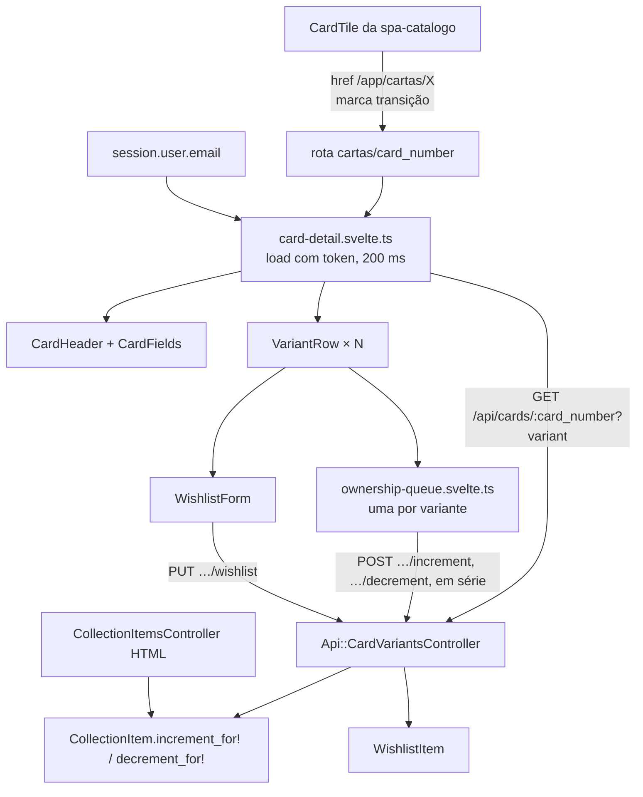

# Design — Detalhe da carta na SPA

**Spec**: `.specs/features/spa-carta/spec.md`
**Status**: Approved (abordagem A do SQL de posse escolhida pelo dono em 2026-10-11)

Restrições ativas: AD-005 (`.context/` vence), AD-023 (SPA em `/app`, mesma origem,
Hotwire no ar até a `spa-troca`), AD-024 (contrato jbuilder, tipos mantidos à mão no
Svelte), AD-025 (dois temas sobre tokens), AD-027 (P9–P11: `card_number` +
`variant_code` no caminho, decremento em zero `200`). Nenhuma é superada. Não há lição
confirmada no `lessons.json`.

Base: SvelteKit 3.0.1 e Svelte 5.57.2 (armadilhas do Kit 3 no `CLAUDE.md`, "Front SPA").

---

## Architecture Overview

Duas metades com um contrato no meio. No Rails, um controller novo
`Api::CardVariantsController` resolve a variante pela chave do AD-027 e grava posse e
desejo do `Current.user`. A posse usa o SQL atômico que hoje vive no
`CollectionItemsController`, movido para o model (abordagem A, abaixo). Na SPA, a rota
`/app/cartas/[card_number]` carrega o detalhe com o mesmo padrão de carregador da
`spa-catalogo` (token de sequência, skeleton após 200 ms). Cada variante tem uma fila de
posse: um módulo puro que guarda o valor confirmado, as operações pendentes e o valor
exibido, e envia uma operação por vez.



### Abordagem para o SQL atômico de posse

O SQL de incremento e decremento (`collection_items_controller.rb:42-89`) vive no
controller HTML, sem model nem serviço. A API precisa exatamente do mesmo SQL.

| | **A. Extrair para o model (recomendada)** | B. Duplicar no controller da API | C. Extrair, mas sem tocar no HTML |
|---|---|---|---|
| Dono do SQL | `CollectionItem.increment_for!(user, variant)` e `.decrement_for!` | Dois controllers | Model para a API, controller HTML com a sua cópia |
| Controller HTML | Passa a chamar o model; comportamento, mensagens e rotas iguais | Intocado | Intocado |
| SCAR-49 ("controllers HTML inalterados; a suíte passa sem edição") | A suíte passa sem edição; o texto pede emenda para "comportamento HTML inalterado" | Cumpre ao pé da letra | Cumpre ao pé da letra |
| Risco | Mexer em código que funciona; a suíte HTML existente é a rede | Duas cópias divergem na primeira correção; já houve um *lost update* nesta camada (T5 da `colecao`) | O mesmo de B até a `spa-troca` apagar o HTML |

**Decidido: A** (dono, 2026-10-11; SCAR-49 e Req. 19.49 emendados). Recomendação original: uma regra de concorrência com dois donos é exatamente o defeito que o
comentário de `collection_items_controller.rb:30-41` existe para evitar, e a suíte HTML
existente (que não muda) prova que o HTML ficou igual. Se o dono preferir C, o resto do
desenho não muda; só a task de extração deixa de tocar no controller HTML.

---

## Code Reuse Analysis

### Existing Components to Leverage

| Component | Location | How to Use |
|---|---|---|
| `Api::BaseController` | `app/controllers/api/base_controller.rb` | Pai do controller novo: sessão exigida por padrão, `render_error`, 404/422/400 já mapeados, locale pt-BR |
| `CardDetail` + `_card`/`_variant` jbuilder | `app/queries/card_detail.rb`, `app/views/api/cards/` | `GET` inalterado; a SPA consome `featured_variant_code`, `variants[]` com `owned_quantity`, `wishlist_target`, `price`, `in_source` |
| SQL atômico de posse | `app/controllers/collection_items_controller.rb:42-108` | Movido para `CollectionItem` (abordagem A) |
| `WishlistItem` (validação, `for_user`) | `app/models/wishlist_item.rb:127-144` | `find_or_initialize_by` + `save`, como o HTML |
| Técnica do teste de corrida | `test/integration/deck_entries_concurrency_test.rb:25-123` | Mesmo `race(lock_sql:)` + `wait_until_blocked` sobre os endpoints da API |
| Helpers de CSRF em teste | `test/integration/api/sessions_test.rb:8-30` | `allow_forgery_protection` no setup, `fetch_token`, `json_headers` |
| `end_to_end_test.rb` (API-17) | `test/integration/api/end_to_end_test.rb:78-109` | Acrescentar as três rotas novas à varredura "JSON, nunca redirect" |
| Cliente HTTP | `frontend/src/lib/api/client.ts` | `get`, `post`, `put`; CSRF, `401` e `session_changed` já tratados |
| Padrão do carregador | `frontend/src/lib/catalog/catalog.svelte.ts` | Mesmo formato (`state`, `load`, `retry`, token, skeleton) num carregador novo para o detalhe |
| `CardTile` | `frontend/src/lib/components/CardTile.svelte:19-46` | Troca o `href` Hotwire pelo da SPA (SCAR-03) e ganha o nome de transição; placeholder e selo servem de modelo para o detalhe |
| `viewTransitionOnNavigate` | `frontend/src/lib/view-transition.ts` | Já abre a transição em troca de pathname; o morph põe `view-transition-name` nos dois elementos. **Emenda (T22)**: o arquivo mudou, ganhou `armArrival` (ver *Morph*) |
| `shell.aside` + `wide` | `frontend/src/lib/shell.svelte.ts` | "Voltar ao catálogo" e a coluna da imagem a partir de 64rem (SCAR-04, SCAR-12) |
| `toasts`, `Button`, `motion.ts`, `safeReturnTo` | `frontend/src/lib/` | Erro de posse (toast), botões de desejo, `return_to` do convite (SCAR-26) |
| Formato de preço e data do HTML | `app/helpers/prices_helper.rb:10-17` | Referência de paridade para o formatador novo do front |

### Integration Points

| System | Integration Method |
|---|---|
| Rotas da API | Três rotas no `scope "api"`, **acima** do catch-all, com `constraints: { card_number: /[^\/]+/, variant_code: /[^\/]+/ }` |
| Banco | Nenhuma migração: `collection_items` e `wishlist_items` já têm `UNIQUE (user_id, card_variant_id)` e os `CHECK` |
| `spa-catalogo` | O tile passa a navegar na SPA; a emenda do SCAT-03 vai para o spec da `spa-catalogo` junto com a task |
| Hotwire | Intocado em comportamento; o e2e de paridade compara `/app/cartas/X?variant=Y` com `/cards/X?variant=Y` |

---

## Components

### Rails

#### `CollectionItem.increment_for!` / `.decrement_for!`

- **Purpose**: Único dono do SQL atômico de posse.
- **Location**: `app/models/collection_item.rb`
- **Interfaces**:
  - `self.increment_for!(user, variant) -> Integer` — `INSERT … ON CONFLICT DO UPDATE SET quantity = quantity + 1 RETURNING quantity`
  - `self.decrement_for!(user, variant) -> Integer | nil` — `UPDATE … WHERE quantity > 0 RETURNING quantity`; `nil` quando não havia o que tirar
- **Dependencies**: `connection.exec_query` com binds `BigInteger`, como hoje.
- **Reuses**: o SQL e o comentário de `collection_items_controller.rb:30-108`, movidos sem alteração; o controller HTML chama estes métodos e mantém mensagens e respostas Turbo.

#### `Api::CardVariantsController`

- **Purpose**: Posse e desejo do usuário da sessão por `card_number` + `variant_code`.
- **Location**: `app/controllers/api/card_variants_controller.rb`, views `app/views/api/card_variants/*.json.jbuilder`
- **Interfaces**:
  - `POST /api/cards/:card_number/variants/:variant_code/increment` → `200 { data: { variant_code, owned_quantity } }` (SCAR-42)
  - `POST …/decrement` → `200` com a quantidade resultante; `decrement_for!` `nil` → `owned_quantity: 0`, sem gravar (SCAR-43, P10)
  - `PUT …/wishlist` com `{ target_quantity }` → `200 { data: { variant_code, wishlist_target } }`; inválido → `422 validation_failed`, "Dados inválidos.", `fields.target_quantity: ["Informe um número inteiro maior ou igual a 1."]` (SCAR-45, SCAR-46)
- **Resolução da variante**: `before_action` com `Card.find_by!(card_number:).card_variants.find_by!(variant_code:)`. Ambos levantam `RecordNotFound` e o base responde `404` (SCAR-47). Não filtra por presença (paridade, *Assumptions*).
- **Autorização**: sessão exigida pelo `Authentication` do base (SCAR-48); todo acesso parte de `Current.user`, sem ler `user_id` de parâmetro.
- **Validação do alvo**: aceita só `Integer` JSON ≥ 1 ou string só de dígitos com valor ≥ 1; `null`, decimal (`1.5`), texto e ausência caem no `422`. A mensagem é a do SCAR-46, escrita no controller, não a do model (que sai em inglês).
- **Corrida do desejo**: `find_or_initialize_by` + `save` pode colidir no `UNIQUE` quando duas abas criam o mesmo desejo; `rescue ActiveRecord::RecordNotUnique` repete uma vez, e a segunda tentativa encontra o registro e atualiza.

### SPA

#### `lib/api/types.ts` (acréscimo)

`CardDetailPayload` (carta + `featured_variant_code` + `variants: DetailVariant[]`), `DetailVariant` (os campos de `_variant.json.jbuilder`, incluindo `art_kind`, `illustrator`, `price: { amount: string; currency: string; observed_at: string } | null`), `OwnershipResult { variant_code; owned_quantity }`, `WishlistResult { variant_code; wishlist_target }`. Mantidos à mão (AD-024).

#### `lib/format.ts`

- **Purpose**: Preço e data com paridade com `prices_helper.rb`.
- **Interfaces**:
  - `formatPrice(amount: string, currency: string): string` — `US$ 1.234,56` para `USD`, `EUR 1.234,56` para outra; `Intl.NumberFormat('pt-BR', { minimumFractionDigits: 2, maximumFractionDigits: 2 })` com a unidade prefixada à mão (o `style: 'currency'` do `Intl` insere espaço inquebrável e muda a unidade por locale).
  - `formatObservedDate(iso: string): string` — `dd/mm/aaaa` em `America/Sao_Paulo` via `Intl.DateTimeFormat`.
  - `copies(n: number): string` — "1 cópia" / "N cópias", usado no selo, na posse e no desejo.
- A imagem `node:24.21.0-slim` traz ICU completo (build oficial do Node); o teste fixa `02:00Z` → dia anterior em São Paulo (SCAR-21).

#### `lib/cards/card-detail.svelte.ts`

- **Purpose**: Carregar o detalhe com descarte de resposta antiga e skeleton tardio.
- **Interfaces**: `createCardDetailLoader(get, skeletonDelayMs = 200) -> { state: { result, error, pending, skeleton, seq }, load(cardNumber, variant), retry() }`.
- **Reuses**: o desenho de `catalog.svelte.ts` (mesmo token, `settle`, relançar erro não-`ApiError`). Módulo à parte em vez de generalizar o do catálogo: o caminho e o envelope diferem (`get` × `getEnvelope`) e só há dois casos.

#### `lib/cards/ownership-queue.svelte.ts`

- **Purpose**: Fila de posse otimista de uma variante (SCAR-27..34).
- **Interfaces**: `createOwnershipQueue({ confirmed, send, onSettled, onError }) -> { readonly displayed: number; readonly confirmed: number; readonly settled: boolean; tap(op: 'increment' | 'decrement'): 'sent' | 'queued' | 'refused'; discard(): void }`, com `send: (op) => Promise<OwnershipResult>`.
- **Regras**:
  - `displayed = confirmed + Σ(pendentes)`; `tap('decrement')` com `displayed === 0` devolve `'refused'` sem enfileirar (SCAR-29).
  - Uma operação em voo por vez; a seguinte sai só depois da resposta da anterior (SCAR-30).
  - Cada resposta atualiza `confirmed` para o `owned_quantity` devolvido. Fila vazia → `displayed === confirmed` (SCAR-31) e `onSettled(quantity)` (anúncio do SCAR-33).
  - Erro → descarta as não enviadas, `displayed = confirmed`, `onError(error)` (SCAR-32).
  - `discard()` (troca de carta, troca de sessão) descarta as não enviadas e ignora a resposta da que está em voo (edge cases).
- Sem DOM e sem cliente embutido: o teste roda com `send` falso e promessas controladas.

#### Componentes (`lib/components/`)

| Componente | Responsabilidade | ACs |
|---|---|---|
| `CardArt` | Quadro fixo com placeholder (nome + `card_number`) por trás da imagem; esconde a imagem no `error`; aceita `transitionName` | SCAR-10, edge case 403 |
| `CardHeader` | Miniatura + `<details>` "Ver imagem maior" abaixo de 64rem; `h1`, chips, linha do set, "Variante fora da fonte", selo, ilustração | SCAR-11..16 |
| `CardFields` | Campos por tipo e seção "Efeito" com texto puro e `white-space: pre-line`. **Emenda (T22)**: indexado pelo `card_type` da API em **minúsculo** (`leader`, `character`, `event`, `stage`) | SCAR-17, 18 |
| `VariantRow` | Miniatura-link (`replaceState`), código, raridade e tipo de arte, set, preço, posse ou convite, desejo | SCAR-19..26 |
| `OwnershipStepper` | `−` `[n]` `+` sobre a fila, região `aria-live="polite"`, `aria-disabled` no zero, foco preservado | SCAR-25, 27..34 |
| `WishlistForm` | `role="group"`, campo "Quero", envio pendente, erro de campo com `aria-describedby` | SCAR-35..38 |

#### Rota `src/routes/cartas/[card_number]/+page.svelte`

- Lê `page.params.card_number` e `page.url.searchParams.get('variant')`; o `$effect` depende do `card_number` e de `session.user?.email` (SCAR-02, SCAR-09). Trocar só o `variant` não refaz a consulta.
- Destaque: `variant` da URL se for de `variants[]`, senão primeira `in_source`, senão primeira (SCAR-24). A troca chama `replaceState` do `$app/navigation` e só muda o estado local (SCAR-23).
- ~~Mantém um `Map<variant_code, OwnershipQueue>` criado a partir de cada resposta aplicada; troca de carta ou de sessão chama `discard()` em todas antes de recriar.~~
- **Emenda (T22)**: não há `Map` na página. Cada `OwnershipStepper` cria a própria fila; a página envolve a lista em `{#key}` por `card_number` + e-mail da sessão, o que recria os steppers, e a fila descarta as operações não enviadas ao desmontar. O valor exibido sobe por `bind:displayed` para o selo do cabeçalho.
- `<title>` por estado (SCAR-01, SCAR-05); "Voltar ao catálogo" em `shell.aside` a partir de 64rem e no topo abaixo dele (SCAR-04).

#### Morph grade → detalhe (SCAR-39..41)

- Um estado de módulo `lib/cards/morph.svelte.ts` guarda o `card_number` da última navegação tile → detalhe ou detalhe → catálogo.
- O `CardTile` aplica `view-transition-name` à arte só quando o `card_number` dele é o marcado; o detalhe aplica o mesmo nome à imagem principal **visível** (miniatura abaixo de 64rem, coluna a partir dele), nunca às duas.
- ~~`viewTransitionOnNavigate` não muda.~~ **Emenda (T22)**: mudou. A View Transition captura o novo estado antes de o detalhe renderizar a arte de destino, e o morph não acontecia. `morph.svelte.ts` ganhou o rendezvous `awaitArrival`/`signalArrival` (teto de 500 ms), e `viewTransitionOnNavigate` chama `armArrival` para esperar o destino renderizado antes de a captura terminar. Continua saindo cedo sem suporte ou com movimento reduzido.
- **Emenda (T22)**: a marca do morph é posta pelo tile e também pela página do detalhe (`markCard`), para a volta.
- O nome é derivado de `card_number` com escape para o conjunto de caracteres de `<custom-ident>` (`P-029`, ponto).

---

## Data Models

Sem migração. Contrato novo (JSON):

```ts
// POST /api/cards/:card_number/variants/:variant_code/(increment|decrement)
interface OwnershipResult { variant_code: string; owned_quantity: number }
// PUT /api/cards/:card_number/variants/:variant_code/wishlist   body: { target_quantity }
interface WishlistResult { variant_code: string; wishlist_target: number }
```

O `variant_code` (`tcgplayer:12345`) vai no caminho com `encodeURIComponent` (`:` vira
`%3A`); o Rails decodifica o segmento antes de chegar a `params`.

---

## Error Handling Strategy

| Error Scenario | Handling | User Impact |
|---|---|---|
| `GET` 404 | Estado `notFound` na rota | `message` da API, "Voltar ao catálogo", título "Carta não encontrada — Bindr" |
| `GET` outro erro | `state.error` | `message` + "Tentar novamente" |
| Posse falha (rede, 500, 404) | Fila descarta pendentes, volta ao confirmado | Toast de erro com a `message` |
| Posse `401` / `session_changed` | Cliente da fundação redireciona ou troca sessão; a fila volta ao confirmado e a troca de sessão refaz o `GET` | Tela de entrar ou detalhe da nova sessão |
| Desejo `validation_failed` | Erro no campo | Mensagem junto do campo, `aria-invalid`, foco no campo |
| Desejo outro erro | Toast de erro | `message` como veio |
| Imagem 403/404 | `CardArt` esconde a imagem | Placeholder |
| Corrida de criação do desejo | `RecordNotUnique` → nova tentativa no servidor | Nenhum |

---

## Risks & Concerns

| Concern | Location (file:line) | Impact | Mitigation |
|---|---|---|---|
| SQL atômico de posse sem teste de corrida | `app/controllers/collection_items_controller.rb:36-41` (só comentário) | A garantia do Req. 7.8 não tem prova; a extração (A) poderia quebrá-la sem alarme | Teste de corrida da API (SCAR-44) com a técnica de `deck_entries_concurrency_test.rb`; cobre o SQL que HTML e API passam a dividir |
| `find_or_initialize_by` + `save` do desejo colide no `UNIQUE` | `app/controllers/wishlist_items_controller.rb:225-237` | Duas abas criando o mesmo desejo dariam `500` na API | `rescue RecordNotUnique` com uma nova tentativa no controller da API; o HTML não muda (fora do escopo) |
| `CardImagesController` busca por `variant_code` global | `app/controllers/card_images_controller.rb:23` | O `UNIQUE` é `(card_id, variant_code)`; dois cards com o mesmo código serviriam a imagem errada | Fora do escopo; registrar no *Handoff* como dívida. Os endpoints novos sempre escopam pela carta |
| Mensagem de validação do model em inglês | `app/models/wishlist_item.rb:127` | Vazaria no `422` | A API escreve a mensagem do SCAR-46 e não usa `errors.full_messages` |
| Nenhum formatador pt-BR no front | — | Paridade de preço e data com o HTML | `lib/format.ts` com testes de paridade contra os mesmos valores do teste do `PricesHelper` |
| Sessão sem evento de troca | `frontend/src/lib/session.svelte.ts` | Refetch e descarte de filas dependem do e-mail como sinal | Mesmo padrão do catálogo (`$effect` sobre `session.user?.email`); a dívida "e-mail como identidade" já está aberta |
| `view-transition-name` duplicado anula a transição | `CardHeader` (miniatura e `<details>` no DOM abaixo de 64rem) | Morph some sem erro | Nome só no elemento visível (decidido por `wide`) e teste de unicidade |

---

## Tech Decisions

| Decision | Choice | Rationale |
|---|---|---|
| Onde fica o SQL de posse | Model (`CollectionItem`), abordagem A | Um dono para a regra de concorrência; decidido pelo dono em 2026-10-11, com o SCAR-49 / Req. 19.49 emendados para "comportamento HTML inalterado" |
| Controller novo × estender `CardsController` | `Api::CardVariantsController` | O `CardsController` é público (`show`); as mutações exigem sessão e partilham a resolução da variante |
| Carregador do detalhe | Módulo novo no padrão do catálogo, sem generalizar | Dois casos com caminho e envelope diferentes; abstração só no terceiro |
| Fila de posse | Módulo puro por variante, injetado com `send` | SCAR-27..34 testáveis sem DOM, com promessas controladas |
| Troca de variante | `replaceState` + estado local | SCAR-23: sem nova consulta e sem item no histórico |
| Unidade do preço | Prefixo à mão + `Intl.NumberFormat` só para o número | Igual ao `number_to_currency(format: "%u %n")` do HTML, sem espaço inquebrável |
