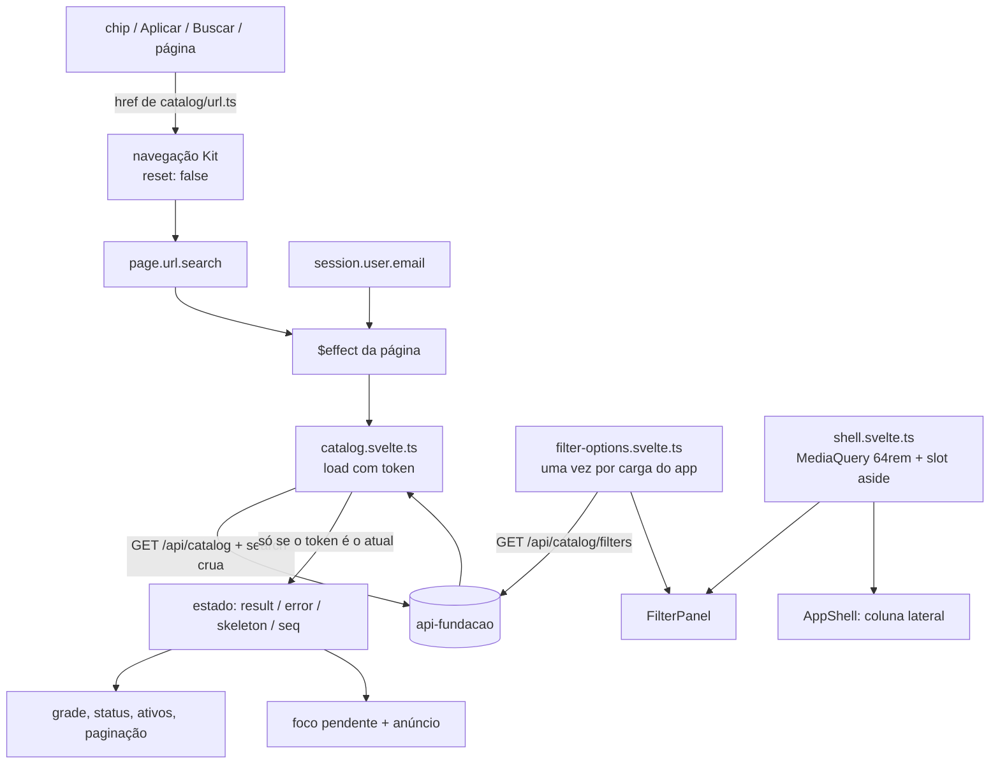

# Design — Catálogo na SPA

**Spec**: `.specs/features/spa-catalogo/spec.md`
**Status**: Approved (dono, 2026-10-10)

Restrições ativas: AD-005 (`.context/` vence), AD-023 (SPA em `/app`, mesma origem),
AD-024 (contrato jbuilder, mantido à mão no lado Svelte), AD-025 (dois temas sobre
tokens). Nenhuma é superada. Não há lição confirmada no `lessons.json`.

Versões instaladas, conferidas em `frontend/node_modules`: SvelteKit 3.0.1, Svelte
5.57.2. Duas coisas do Kit 3 decidem este desenho e diferem da doc antiga:

- `goto` não aceita mais `keepFocus` nem `noScroll`: em dev, passá-los dispara
  `goto_options_removed`. O substituto é `goto(url, { reset: false })`, que deixa
  rolagem e foco onde estão. Nos links, o atributo é `data-sveltekit-reset="false"`;
  `data-sveltekit-keepfocus` e `-noscroll` só geram aviso
  (`@sveltejs/kit/src/runtime/client/utils.js:179`, `client.js:2626`).
- `MediaQuery` existe em `svelte/reactivity` (`svelte/src/reactivity/media-query.js:37`).

---

## Architecture Overview

A URL é a fonte de verdade. A página `/app` observa `page.url.search` e o e-mail
da sessão; cada mudança de um dos dois dispara uma consulta. Um carregador com
token de sequência descarta resposta que não seja da consulta mais recente. Todo
link da tela sai de uma função pura sobre `meta.active_filters` da última
resposta, porta direta do `CatalogHelper`.

A navegação dentro do catálogo usa `href` real com `data-sveltekit-reset="false"`.
Busca e "Aplicar" usam `goto(href, { reset: false })`. A URL troca na hora e a
resposta chega depois. O layout deixa de mover o foco e de abrir View Transition
quando só a query muda.



### Abordagem escolhida e alternativa

| | **A. Carregador no componente (escolhida)** | B. `load` do Kit em `+page.ts` |
|---|---|---|
| Resposta antiga (SCAT-08) | Token de sequência, comparação explícita | O router do Kit cancela a navegação anterior |
| Manter conteúdo e skeleton após 200 ms (SCAT-38) | Timer no carregador | `navigating` do `$app/state` com timer na página |
| Erro inline com busca e filtros usáveis (SCAT-39) | Estado `error` do carregador | O `load` precisa capturar e devolver o erro como dado, senão cai no `+error.svelte` e a tela some |
| Refazer na troca de sessão (SCAT-09) | O e-mail é dependência do `$effect` | `depends` + `invalidate` disparado por `$effect` |
| URL na barra durante a espera | Muda na hora; voltar e avançar respondem logo | Só muda quando o `load` termina, e o clique parece não ter acontecido |
| Teste (Vitest) | Carregador testável sem montar rota, com cliente falso injetado | Precisa simular o ciclo do router |

A alternativa B é a forma idiomática do Kit, mas três dos cinco pontos acima viram
contorno dentro dela. A escolha A deixa cada regra num lugar que o teste alcança
direto.

---

## Code Reuse Analysis

### Existing Components to Leverage

| Componente | Local | Uso |
|---|---|---|
| Cliente HTTP | `frontend/src/lib/api/client.ts` | Ganha `getEnvelope` (Data Models). O caminho vai como `'/api/catalog' + search`: o `isLocalPath` aceita, e a query chega crua (SCAT-04) |
| `ApiError` e mensagens | `frontend/src/lib/api/errors.ts` | A `message` vai como veio para os erros inline (SCAT-39, 40) |
| Sessão | `frontend/src/lib/session.svelte.ts` | `session.user` decide selo, posse e convite, e o e-mail é dependência da consulta |
| `safeReturnTo` | `frontend/src/lib/navigation/return-to.ts` | Valida o `return_to` do convite (SCAT-31) e precisa de ajuste (Risks) |
| `appPath` / `navEntries` | `frontend/src/lib/navigation/nav-entries.ts` | "Catálogo" passa a `inApp("Catálogo", "/")` (SCAT-02) |
| `MainNav` | `frontend/src/lib/components/MainNav.svelte` | `isCurrent` já compara só o `pathname`, com a barra final aparada, então `/app?…` marca "Catálogo" sem mudança |
| `AppShell` | `frontend/src/lib/components/AppShell.svelte` | Ganha o slot da coluna lateral (SCAT-33) |
| `Button` | `frontend/src/lib/components/Button.svelte` | "Buscar", "Aplicar", "Tentar novamente" |
| Tokens e corte de movimento | `tokens.css`, `base.css`, `motion.ts` | O skeleton anima só `opacity` e para com movimento reduzido (o `guard.test.ts` varre) |
| `CatalogHelper` | `app/helpers/catalog_helper.rb` | Referência da porta: rótulos, chip por valor, remoção, alternância, limpar, paginação |
| `_card_tile.html.erb`, `catalog.css` | `app/views/catalog/`, `app/assets/stylesheets/catalog.css:214-330` | Placeholder atrás da imagem em CSS, `aspect-ratio: 5 / 7`, selo no canto, 2 colunas que viram 5 a partir de 64rem |

### Integration Points

| Sistema | Integração |
|---|---|
| `GET /api/catalog` | Query da URL repassada; `data` (cartas com `variants[]`) e `meta` (`page`, `per_page`, `total_count`, `total_pages`, `active_filters`) |
| `GET /api/catalog/filters` | `{ colors, card_types, rarities: string[]; sets: {code, name}[] }`, já ordenados; chamado uma vez por carga do app |
| Detalhe Hotwire | `<a href="/cards/{encodeURIComponent(card_number)}" rel="external" data-sveltekit-reload>`, mesmo padrão das entradas Hotwire do `MainNav` |
| Layout | `+layout.svelte`: `afterNavigate` e `onNavigate` ganham a guarda de mesma rota |

---

## Components

### URL do catálogo — `src/lib/catalog/url.ts` (SCAT-05, 06, 16, 19, 23, 24, 28, 30, 36)

- **Purpose**: transformar `active_filters` em links. É a porta do `CatalogHelper` e o único lugar com teste de combinação de parâmetro no front.
- **Interfaces**:
  - `catalogHref(filters: ActiveFilters): string`: `/app` mais `?` e os parâmetros na ordem das chaves, ou só `/app` sem parâmetro. Lista vira `chave[]=valor` repetido; escalar vira `chave=valor`. A serialização usa `URLSearchParams.append`, que escreve `colors%5B%5D=Red`, a mesma forma do `to_query` do Rails.
  - `toggleHref(filters, key, value)`: numa lista, acrescenta ou remove o valor. Em `owned`, liga o valor, ou remove a chave se ela já tem esse valor ou se o valor é `all`. Sempre sem `page`.
  - `withoutHref(filters, key, value)`: tira um valor, ou a chave se for escalar. Sem `page`.
  - `pageHref(filters, page)`: os mesmos filtros com `page`.
  - `clearHref(filters)`: só `sort` e `dir`.
  - `searchHref(filters, term)`: `q` com `trim`, sem `q` se vazio; demais filtros mantidos, sem `page`.
  - `setHref(filters, choice: string | null)`: `null` ("N sets selecionados") mantém tudo; `''` ("Todos os sets") remove `sets`; um código põe `sets = [código]`. Sem `page`.
  - `filterChips(filters): Chip[]`: um chip por valor, na ordem das chaves e depois dos valores, sem `sort`, `dir`, `page` e `per_page`. `Chip = { key, value, label, text, href }`, com `text = "<label>: <valor exibido>"`. Posse sai "Tenho" ou "Não tenho".
  - `FILTER_LABELS`: o mapa do `CatalogHelper` mais `owned: "Posse"`.
- **Dependencies**: `appPath`.
- **Reuses**: a semântica do `CatalogHelper`. Isso inclui a perda de `per_page` na paginação, que o HTML também tem (Risks).

### Carregador — `src/lib/catalog/catalog.svelte.ts` (SCAT-04, 08, 09, 38, 39)

- **Purpose**: buscar a página da URL atual e expor só o resultado dela.
- **Interfaces**: `createCatalogLoader(get: (path: string) => Promise<CatalogPage>, skeletonDelayMs = 200)` devolve três membros:
  - `state` (`$state`): `{ result: CatalogPage | null; error: ApiError | null; pending: boolean; skeleton: boolean; seq: number }`.
  - `load(search: string): void`:
    1. Incrementa o token, marca `pending`, agenda o skeleton para 200 ms e chama `get('/api/catalog' + search)`.
    2. Ao responder, só grava se o token ainda for o atual.
    3. Sucesso grava `result`, zera `error` e incrementa `seq`.
    4. `ApiError` grava `error`, mantém `result` e incrementa `seq`. Qualquer outro erro é relançado.
    5. Em todos os casos cancela o timer e zera `skeleton`.
  - `retry(): void`: `load` com a última `search`.
- **Dependencies**: `ApiError`. A página injeta `(path) => api.getEnvelope(path)`.
- **Ligação na página**: um `$effect` lê `page.url.search` e `session.user?.email` e chama `loader.load(page.url.search)`. O e-mail entra só como dependência do efeito, para que a troca de sessão refaça a consulta (SCAT-09).
- **`seq`**: contador de respostas aplicadas. Muda a cada resposta, inclusive com texto igual, e por isso dispara o foco pendente e o anúncio.

### Opções de filtro — `src/lib/catalog/filter-options.svelte.ts` (SCAT-18, 40)

- **Purpose**: chamar `GET /api/catalog/filters` uma vez por carga do app, com nova tentativa.
- **Interfaces**: `filterOptions: { value: FilterOptions | null; error: ApiError | null; loading: boolean }`, `ensureFilterOptions(): void` (não faz nada se já há valor ou carga em curso), `retryFilterOptions(): void`.
- **Por que módulo e não página**: o painel remonta ao cruzar 64rem, e a busca das opções não pode se repetir (edge case "sem refazer a consulta").

### Slot da coluna lateral — `src/lib/shell.svelte.ts` + `AppShell.svelte` (SCAT-33, 34, 35)

- **Purpose**: deixar a página pôr conteúdo na coluna lateral do casco, abaixo da navegação.
- **Interfaces**: `shell: { aside: Snippet | null }` (`$state`) e `wide = new MediaQuery('min-width: 64rem')`.
- **AppShell**: em `.nav`, depois de `<MainNav />`, `{#if wide.current && shell.aside}<div class="aside">{@render shell.aside()}</div>{/if}`.
- **Página**: registra o snippet do painel num `$effect` com limpeza (`shell.aside = panel; return () => (shell.aside = null)`). Abaixo de 64rem, renderiza o mesmo snippet dentro de `<details>` acima da grade. Só uma instância existe por vez, então não há id duplicado nem controle escondido na ordem de tabulação.
- **Painel aberto (SCAT-35)**: o `open` do `<details>` é `$state` da página com `bind:open`. Ele sobrevive à navegação de query, porque a página não remonta na mesma rota, e também a cruzar 64rem e voltar.
- **Barra inferior abaixo de 64rem**: o slot não aparece lá, porque `wide.current` é falso.

### Componentes de tela

Ficam em `src/lib/components/`, na pasta plana da fundação. Os específicos do
catálogo levam o prefixo `Catalog`.

| Componente | Critérios | Props | Notas |
|---|---|---|---|
| `CardTile.svelte` | 3, 10–13 | `card: CatalogCard`, `signedIn: boolean` | `<li>` com link de página inteira. Na arte (`aspect-ratio: 5 / 7`), o placeholder `aria-hidden` fica sempre por baixo e o `` por cima, só quando há `image_url`. Imagem quebrada não pinta nada e o placeholder aparece, sem `onerror`, como no HTML. Selo `role="img"` só com `signedIn` e soma maior que zero. Raridade omitida quando `null` |
| `CardTileSkeleton.svelte` | 38 | — | Mesmo contorno do tile (arte 5/7, duas linhas de texto), `aria-hidden`. Pulso só em `opacity` com `--duration-slow`, parado com movimento reduzido pelo corte do `base.css` |
| `FilterChip.svelte` | 19–22, 25 | `href`, `label`, `active`, `current?: boolean`, `swatch?: boolean`, `removeName?: string` | Link com `data-sveltekit-reset="false"` e 44px de altura. Ativo: anel sólido de 2px em `accent`, `×` `aria-hidden` e `aria-label = removeName`. `current` (o "Todas" sem filtro) põe `aria-current="true"` sem `×`. `swatch` é o quadrado neutro em `border-strong` (P8) |
| `CatalogSearch.svelte` | 15–17 | `value: string`, `onsearch(term)` | `<form role="search">` com rótulo visível, `type="search"` e placeholder "OP01-024". O campo segue `value` (o `active_filters.q`) e troca quando a resposta muda (SCAT-07, 17) |
| `CatalogStatus.svelte` | 29–32 | `total`, `chipCount`, `clearHref?`, `signInHref?` | `<p tabindex="-1">` com a frase (alvo de foco do SCAT-42 e do SCAT-43) e os dois links à direita |
| `ActiveFilters.svelte` | 28, 42 | `chips: Chip[]`, `onremove(index)` | `<ul aria-label="Filtros ativos">` com um `FilterChip` ativo por chip, num `{#each}` com chave `key + value` |
| `FilterPanel.svelte` | 18–27, 40 | `filters: ActiveFilters`, `signedIn` | Grupos Cor, Tipo, Raridade, Set (`<form>` com `<select>` e "Aplicar") e Posse. Lê `filterOptions`; com erro, mostra a `message` e "Tentar novamente" no lugar dos grupos |
| `CatalogPagination.svelte` | 36, 43 | `meta`, `onpage()` | `<nav aria-label="Paginação do catálogo">`; links com `rel`, `data-sveltekit-reset="false"` e um `onclick` que registra o foco pendente |

### Página — `src/routes/+page.svelte` (SCAT-01, 07, 14, 37, 41–44)

- Título "Catálogo — Bindr" e `<h1>Catálogo</h1>`.
- No cabeçalho, `CatalogSearch` e `CatalogStatus` ficam na mesma linha a partir de 64rem (SCAT-32). `ActiveFilters` vem abaixo, fora do `<details>`.
- A região de resultados é `<section aria-busy={skeleton}>`, nesta precedência:
  1. skeleton;
  2. erro, com a `message` e "Tentar novamente" (`loader.retry()`);
  3. vazio;
  4. grade com a paginação.
- A grade é um `<ul>` com 2 colunas, e 5 a partir de 64rem.
- **Anúncio (SCAT-44)**: um `<p class="visually-hidden" role="status">` fica sempre montado. A cada `seq`, a página o esvazia e grava a frase depois de `tick()`, para que até a mesma frase seja anunciada. Com erro, anuncia a `message`.
- **Foco pendente (SCAT-42, 43)**: `pendingFocus: { kind: 'chip'; index } | { kind: 'status' } | null`. A remoção grava `{ chip, index }`, e a paginação grava `{ status }`. Num `$effect` sobre `seq`, depois de `tick()`, a página foca o chip `index`; se ele não existir, o `index - 1`; e, se a lista ficar vazia, a linha de status. Depois zera o registro.
- **Foco mantido (SCAT-41)**: chips e paginação usam `data-sveltekit-reset="false"`; busca e "Aplicar" usam `goto(href, { reset: false })`. O chip do painel tem chave estável, porque as opções não mudam, e o mesmo elemento continua focado.

### Layout — `src/routes/+layout.svelte` e `src/lib/view-transition.ts` (SCAT-41)

- `afterNavigate`: também retorna cedo quando `navigation.from?.url.pathname === navigation.to?.url.pathname`. Hoje o foco já fica onde está se estiver dentro de `main`. A partir de 64rem, porém, o chip mora na coluna lateral, fora de `main`, e seria puxado para `main#conteudo`.
- `viewTransitionOnNavigate`: sem transição na mesma rota. O SPA-43 fala de navegação "entre rotas"; sem essa guarda, cada chip faria um cross-fade da tela inteira antes de a resposta chegar.

---

## Data Models

```typescript
// src/lib/api/types.ts — espelho manual dos jbuilders (AD-024)
export type CatalogVariant = {
  variant_code: string;
  rarity: string | null;
  art_kind: string;
  set: { code: string; name: string };
  illustrator: string | null;
  image_url: string | null;
  in_source: boolean;
  owned_quantity: number | null; // null sem sessão (VariantHoldings#owned_quantity)
  wishlist_target: number | null;
  price: { amount: string; currency: string; observed_at: string } | null;
};

export type CatalogCard = {
  card_number: string;
  name: string;
  card_type: string;
  colors: string[];
  cost: number | null;
  life: number | null;
  power: number | null;
  counter: number | null;
  block_icon: number | null;
  attributes: string[];
  traits: string[];
  effect_text: string | null;
  trigger_text: string | null;
  set: { code: string; name: string };
  variants: CatalogVariant[];
};

export type ActiveFilters = Partial<{
  q: string;
  colors: string[]; card_types: string[]; sets: string[]; rarities: string[];
  attributes: string[]; traits: string[];
  cost_min: number; cost_max: number; power_min: number; power_max: number;
  counter_min: number; counter_max: number;
  owned: 'owned' | 'missing';
  sort: string; dir: 'asc' | 'desc';
}>;

export type CatalogMeta = {
  page: number; per_page: number; total_count: number; total_pages: number;
  active_filters: ActiveFilters;
};

export type CatalogPage = { data: CatalogCard[]; meta: CatalogMeta };

export type FilterOptions = {
  colors: string[]; card_types: string[]; rarities: string[];
  sets: { code: string; name: string }[];
};
```

O cliente devolve só `data` do envelope (`client.ts:107-109`, `return data as T`),
e `meta` se perde, mas o carregador precisa dos dois. Por isso o cliente ganha
`getEnvelope<T, M>(path)`, que devolve `{ data, meta }` e passa pelas mesmas
regras de erro. É a única mudança no cliente, e ele continua sendo o único
módulo com `fetch` (SPA-06). A API não muda (SCAT-45).

---

## Error Handling Strategy

| Cenário | Tratamento | O que o usuário vê |
|---|---|---|
| `network_error`, `unexpected_response` ou `500` em `/api/catalog` | O carregador grava `error` | No lugar da grade, a `message` e "Tentar novamente"; busca, painel e ativos seguem usáveis (SCAT-39) |
| Falha em `/api/catalog/filters` | `filterOptions.error` | No painel, a `message` e "Tentar novamente"; a grade fica intacta (SCAT-40) |
| Resposta de uma consulta antiga | O token difere e a resposta é descartada | Nada muda (SCAT-08) |
| Parâmetro inválido na URL | A API ignora e responde `200` | Resultado normal, e nenhum link gerado traz o parâmetro (SCAT-06) |
| `page` além da última | `data` vazio com `total_count` real | Estado vazio, status com o total e paginação com "Anterior" |
| Imagem com `403`, `404` ou `null` | Nenhum JS | Placeholder visível |
| `401` em `/api/catalog` | Não deve acontecer, porque o endpoint é público. Se acontecer, o cliente já chama `handleUnauthenticated` | Vai para `/app/entrar` |
| Erro que não é `ApiError` | Relançado | É erro de programação, não estado de tela |

---

## Risks & Concerns

| Concern | Location (file:line) | Impact | Mitigation |
|---|---|---|---|
| `safeReturnTo` só aceita `/app/…`, então o convite `/app/entrar?return_to=/app?colors[]=Red` voltaria para `/app` sem a query | `frontend/src/lib/navigation/return-to.ts:25` | O usuário entra e perde os filtros (SCAT-31) | Aceitar também `raw === base` e `raw.startsWith(base + '?')`, mantendo as outras recusas; teste novo em `return-to.test.ts` |
| O cliente descarta `meta` | `frontend/src/lib/api/client.ts:107-109` | Sem `meta` não há contagem, paginação nem `active_filters` | `getEnvelope` no cliente (Data Models) |
| `signOut` vai para `/app` sem query | `frontend/src/lib/session.svelte.ts:53` | Sair em `/app?owned=owned` leva ao catálogo sem filtro nenhum, não à mesma URL sem o `owned` | Aceito: é o comportamento da fundação, e o edge case pede refazer a consulta, o que acontece. A "URL atual" depois de sair é `/app` |
| A paginação não carrega `per_page` | `app/helpers/catalog_helper.rb:58`; o `active_filters` não traz `per_page` | `?per_page=50` volta a 25 na página 2 | Paridade com o HTML, mantida e registrada |
| `MediaQuery` e `matchMedia` no jsdom | `src/lib/shell.svelte.ts` (novo) | Testes que montam `AppShell` ou a página quebram sem `matchMedia` | `vi.stubGlobal('matchMedia', …)`, como `layout.svelte.test.ts:8` já faz |
| O e2e da fundação confere o e-mail em `main` | `frontend/e2e/sessao.spec.ts:67,106,113,123,149,156` | Quebra quando `/app` vira o catálogo | Trocar o sinal de sessão pela entrada "Sair" da navegação (previsto no spec) |
| `+page.svelte` e `page.test.ts` da fundação | `frontend/src/routes/+page.svelte`, `page.test.ts` | Os testes do início deixam de valer | Reescritos para o catálogo; o comportamento antigo sai por decisão do spec |
| "Catálogo" ainda aponta para o Hotwire | `frontend/src/lib/navigation/nav-entries.ts:24` | A entrada recarrega a página e não marca `aria-current` | `inApp("Catálogo", "/")`, com `nav-entries.test.ts` e `MainNav.test.ts` emendados |
| Não há classe `visually-hidden` | `frontend/src/lib/styles/base.css` | A região de anúncio ficaria visível | Acrescentar a regra em `base.css`, sem px de token (`1px` não é token, e o guarda o aceita) |
| O e2e de paridade lê `/catalog` pelo proxy | serviço `e2e` → `frontend:5173/catalog` | Depende do banco de dev com import | O teste lê as duas telas na mesma execução; sem catálogo, vazio bate com vazio |

---

## Tech Decisions

| Decisão | Escolha | Por quê |
|---|---|---|
| Onde mora a consulta | Carregador no componente, com token (abordagem A) | Ver a tabela da Architecture Overview |
| Navegação sem perder foco | `data-sveltekit-reset="false"` e `goto(…, { reset: false })` | É a única forma no Kit 3.0.1; `keepFocus` e `noScroll` foram removidos |
| Serialização da URL | `URLSearchParams.append` com `chave[]` | É a biblioteca do navegador, e escreve a mesma forma do `to_query` do Rails, então `/app?…` e `/catalog?…` trocam entre si |
| Um painel, dois lugares | `MediaQuery` decide onde o único painel é montado | Duas instâncias trariam id duplicado e o estado do `<details>` dividido; mover por CSS exigiria `display: contents` em `main` |
| Repetir o anúncio | Esvaziar e regravar a região depois de `tick()` | Uma região viva não anuncia texto igual ao anterior |
| Busca preserva filtros | `searchHref` mantém tudo menos `page` | Escolha do spec, divergência deliberada do HTML |

Nenhuma decisão aqui vira AD, porque todas são locais à tela. A exceção possível
é o slot `shell.aside`: se a `spa-pasta` o reusar para os filtros dela, ele vira
padrão e ganha uma AD.
