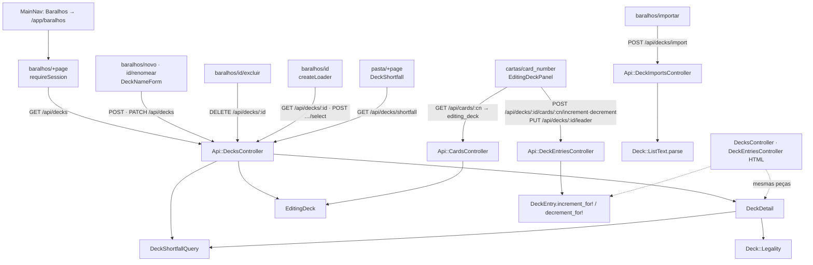

# Design — Decks na SPA

**Spec**: `.specs/features/spa-decks/spec.md`
**Status**: Approved (A1 e B1 escolhidas pelo dono em 2026-10-11; B1 vira AD-030)

Restrições ativas: AD-005 (`.context/` vence), AD-021 (a pasta Hotwire em três
consultas; o bloco da SPA tem endpoint próprio), AD-023 (SPA em `/app`, Hotwire no ar),
AD-024 (jbuilder, tipos à mão no Svelte), AD-025 (dois temas), AD-027 (P10: decremento
sem entrada é `200` com zero), AD-028 (ação lateral em `shell.aside`), AD-029 (P12: id do
deck no caminho). Nenhuma é superada. Não há lição confirmada no `lessons.json`.

**Pré-condição de execução:** `spa-carta` e `spa-pasta` encerradas (estão). A fatia mexe
em arquivos delas (`cards_controller.rb`, `cards/show.json.jbuilder`, `types.ts`,
`ownership-queue.svelte.ts`, `OwnershipStepper.svelte`, `cartas/[card_number]/+page.svelte`,
`pasta/+page.svelte`); não rodar em paralelo com outra fatia no mesmo checkout.

---

## Architecture Overview

Duas metades com o contrato no meio, como nas fatias anteriores. No Rails, três
controllers de API novos (`decks`, `deck_entries`, `deck_imports`) reaproveitam
`Deck::Legality`, `Deck::ListText`, `DeckShortfallQuery` e o concern `EditingDeck`; o
`Api::CardsController` ganha o campo `editing_deck`. Na SPA, seis rotas sob
`/app/baralhos`, uma seção nova no detalhe da carta e um bloco novo na pasta.



### Duas escolhas que pedem o seu aval

**A — onde mora a lógica que o HTML já tem inline no controller.** O SQL atômico de
entrada (`deck_entries_controller.rb:42-101`) e a montagem da página do deck
(`decks_controller.rb:52-66,111-123`: retrato `REPEATABLE READ`, cartas fora da fonte,
falta por carta) estão nos controllers HTML.

| | Abordagem | Custo | Risco |
|---|---|---|---|
| **A1 (recomendada)** | Extrair `DeckEntry.increment_for!`/`decrement_for!` (como a `spa-carta` fez com `CollectionItem`) e um `DeckDetail` (irmão do `CardDetail`); os dois controllers HTML passam a chamá-los, sem mudar resposta, mensagem nem rota | Um model method e uma classe nova, com teste próprio | Toca dois controllers HTML; o SDEC-61 é lido como "a suíte existente passa sem edição" (mesma leitura do SCAR-49) |
| A2 | Copiar o SQL e a montagem para os controllers da API | Zero mudança no HTML | Duas cópias do SQL de concorrência e do retrato único; uma correção num não chega ao outro |

A1 deixa um dono por invariante (teto de 50, nunca abaixo de 1, retrato único), que é
exatamente o que o teste de corrida protege.

**B — o stepper do deck.** A fila e o stepper da `spa-carta` quase servem: a fila lê
`result.owned_quantity` (`ownership-queue.svelte.ts:37`) e o stepper tem rótulos e a
frase de recusa fixos (`OwnershipStepper.svelte:17,25,57,66`).

| | Abordagem | Custo | Risco |
|---|---|---|---|
| **B1 (recomendada)** | Generalizar: `send` da fila devolve `Promise<number>` (quem chama mapeia `r => r.owned_quantity` ou `r => r.quantity`); extrair `QuantityStepper.svelte` com rótulos, recusa e texto da quantidade por prop; `OwnershipStepper` vira um invólucro fino dele, com a mesma marcação | Mexe em dois arquivos da `spa-carta` | Os testes da `spa-carta` têm de passar sem edição; se algum depender do formato do `send`, ajusta-se só o mock |
| B2 | Copiar fila e stepper para `deck-queue.svelte.ts` e `DeckStepper.svelte` | Nada da `spa-carta` muda | Duas filas em série com a mesma regra de falha (SCAR-32) mantidas em dobro |

---

## Code Reuse Analysis

### Existing Components to Leverage

| Componente | Local | Uso |
|---|---|---|
| `Deck::Legality.call(leader:, entries:)` | `app/models/deck/legality.rb` | `status`, `reasons`, `warnings` da lista e da página (SDEC-43, SDEC-47); puro, sem banco |
| `Deck#ordered_entries`, `#main_total`, `#legality` | `app/models/deck.rb:40,49,54` | Ordem do DCK-07 e total (SDEC-26, SDEC-47) |
| `Deck` (`normalizes :name`, `NAME_LENGTH`, mensagens) | `app/models/deck.rb:25-29` | Regra do nome (SDEC-46); a API só prefixa "O nome " e põe ponto, como `_name_form.html.erb:18` |
| `Deck::ListText.parse` / `Result(errors: [{line, message}])` | `app/models/deck/list_text.rb:24` | Importação e recusa por linha (SDEC-57, SDEC-58) |
| `DeckShortfallQuery.new(user, deck:)` | `app/queries/deck_shortfall_query.rb` | Falta por carta na página (SDEC-28) e bloco da pasta (SDEC-59) |
| `ProgressController#load_deck_shortfall` | `app/controllers/progress_controller.rb:46-51` | Mesmo filtro `missing.positive?` e decks numa consulta para o `shortfall` |
| `EditingDeck` (`editing_deck`, `start_editing`) | `app/controllers/concerns/editing_deck.rb` | `editing` do deck, `select`, criação/importação e `editing_deck` no detalhe (SDEC-19, SDEC-49, SDEC-50) |
| `Api::BaseController` (`render_error`, `rescue_from`) | `app/controllers/api/base_controller.rb:40` | 401, 404, 422 de CSRF, `invalid_json`, `validation_failed` com `fields` |
| `DecksHelper::DECK_STATUS_LABELS`, `DECK_GROUP_LABELS` | `app/helpers/decks_helper.rb` | Textos que a SPA copia em `lib/decks/labels.ts` (paridade) |
| Teste de corrida de deck | `test/integration/deck_entries_concurrency_test.rb` | Molde do teste da API (SDEC-56) |
| Helpers de request test da API | `test/integration/api/card_variants_test.rb:33-51` | `json_headers`, `fetch_token`, `sign_in` |
| `createLoader<T>` | `frontend/src/lib/api/loader.svelte.ts:11` | Lista, página do deck e bloco da pasta; o 404 é derivado na página de `state.error.code === 'not_found'`, sem mudar o carregador |
| `requireSession` | `frontend/src/lib/navigation/require-session.ts` | Seis `+page.ts` (SDEC-03) |
| `createOwnershipQueue`, `OwnershipStepper` | `frontend/src/lib/cards/` · `components/` | Base do `QuantityStepper` (B1) |
| `TextField` (`errors`, `focus()`), `FormError` (`role="alert"`, `focus()`), `Button` (`pending`) | `frontend/src/lib/components/` | Formulários (SDEC-10, SDEC-13, SDEC-14, SDEC-32) |
| `distribute(error)` de `criar-conta` | `frontend/src/routes/criar-conta/+page.svelte:29-39` | Molde de `fields` → campo |
| `notifySuccess`, `notifyError` | `frontend/src/lib/toasts.svelte.ts` | Mensagens de sucesso; o `Toaster` está no layout raiz e sobrevive ao `goto` |
| `cardDetailHref`, `appPath`, `encodeURIComponent` por segmento | `frontend/src/lib/cards/url.ts`, `navigation/nav-entries.ts` | Links e caminhos da API |
| `MainNav.isCurrent` (igualdade exata de `pathname`) | `frontend/src/lib/components/MainNav.svelte:10` | Já dá o SDEC-02 e o Out of Scope (só `/app/baralhos` marcado) |
| Telas Hotwire de deck | `app/views/decks/*.html.erb`, `deck_imports/new.html.erb`, `decks/_shortfall` | Textos e composição de referência |

### Integration Points

| Sistema | Integração |
|---|---|
| Rotas Rails | No `scope "api"`, acima do catch-all e nesta ordem: `get "decks/shortfall"`, `post "decks/import"`, `resources :decks, only: %i[index show create update destroy]` com `member { post :select }`, e as três rotas de entrada com `constraints: { card_number: /[^\/]+/ }` |
| Banco | Nenhuma migração. Escritas só em `decks` e `deck_entries`, pelos mesmos caminhos do HTML |
| HTML | `DecksController#show` usa `DeckDetail`; `DeckEntriesController` usa `DeckEntry.increment_for!`/`decrement_for!` (A1); respostas, mensagens e rotas iguais |
| Detalhe da carta | `GET /api/cards/:card_number` ganha `editing_deck` (aditivo, SDEC-50) |
| Casco | "Baralhos" deixa de ser `hotwire("Baralhos", "/decks")` e vira `inApp("Baralhos", "/baralhos")` |

---

## Components

### `DeckEntry.increment_for!(deck, card)` / `.decrement_for!(deck, card)` (Rails)

- **Purpose**: o SQL atômico de entrada num dono só.
- **Location**: `app/models/deck_entry.rb`
- **Interfaces**:
  - `increment_for!(deck, card) → Integer | nil` — o `INSERT … ON CONFLICT … WHERE quantity < 50 RETURNING quantity` de hoje; `nil` é o teto.
  - `decrement_for!(deck, card) → Integer | nil` — a transação de três comandos de hoje (`FOR UPDATE`, `UPDATE … quantity > 1`, `DELETE … quantity = 1`); `0` quando apagou, `nil` sem entrada.
- **Reuses**: o SQL de `deck_entries_controller.rb:42-101`, movido sem mudar; binds `BigInteger` como `CollectionItem.execute_returning_quantity`.

### `DeckDetail` (Rails)

- **Purpose**: tudo que a página do deck lê, num retrato só.
- **Location**: `app/queries/deck_detail.rb` (ao lado de `CardDetail`).
- **Interfaces**: `DeckDetail.new(user:, deck_id:).call → Result(deck, legality, absent_card_ids, shortfall_by_card_id)`; `RecordNotFound` para deck alheio ou inexistente.
- **Detalhes**: `consistent_snapshot` e `absent_card_ids` saem do `DecksController` para cá, como estão (inclusive o "sem `REPEATABLE READ` dentro de transação aberta").
- **Usado por**: `DecksController#show` (HTML) e `Api::DecksController#show`.

### `Api::DecksController` (Rails)

- **Location**: `app/controllers/api/decks_controller.rb`, views em `app/views/api/decks/`.
- **Includes**: `EditingDeck`. Sessão obrigatória (default do base). Todo deck sai de `Current.user.decks`; `user_id` no corpo é ignorado por construção.
- **Actions**:
  - `index` — `Current.user.decks.includes(:leader, entries: :card).order(:name, :id)`; `_summary.json.jbuilder`: `id`, `name`, `leader` (`{card_number, name}` ou `null`), `main_total`, `status` (SDEC-43). Consultas fixas com 1 e 3 decks.
  - `show` — `DeckDetail`; `show.json.jbuilder` com o formato do SDEC-47, `editing: editing_deck&.id == deck.id`, `missing_total` = soma de `missing` das linhas.
  - `create` — `Deck.new(user: Current.user, name: name_param)`; sucesso: `start_editing`, `201` com `show` (lido por `DeckDetail`).
  - `update` — só `name`; `200` com `show`.
  - `destroy` — `deck.destroy!`; `200 { id, name }`.
  - `select` — `start_editing(deck)`; `200 { id, name }`.
  - `shortfall` — `DeckShortfallQuery.new(Current.user).call.select { missing.positive? }`, decks por `Current.user.decks.where(id:).pluck(:id, :name)`; `decks` de cada carta ordenados por id (SDEC-59). Duas consultas, a segunda só quando há linhas.
- **Nome** (`name_param`): `params[:name]` só se for `String`, senão `nil` (o model recusa com "não pode ficar vazio"); recusa → `render_error(422, "validation_failed", "Dados inválidos.", name: deck.errors[:name].map { "O nome #{_1}." })` (SDEC-46).

### `Api::DeckEntriesController` (Rails)

- **Location**: `app/controllers/api/deck_entries_controller.rb`.
- **Before**: `set_deck` (`Current.user.decks.find(params[:id])`), `set_card` (`Card.find_by!(card_number: params[:card_number])`); `rescue_from ActiveRecord::InvalidForeignKey` → `not_found` (deck excluído no meio, como o HTML).
- **Actions**:
  - `increment` — Leader → `422` com a frase do HTML (SDEC-54); `nil` → `422` "O máximo é 50 cópias por carta no deck." (SDEC-53); senão `200 { card_number, quantity }`.
  - `decrement` — `decrement_for!(…).to_i` → `200 { card_number, quantity }` (zero sem entrada, SDEC-52).
  - `leader` — `card_number` do corpo (`String` ou 404); não-Leader → `422` com a frase do HTML; senão `update!(leader:)` e `200 { leader_card_number }` (SDEC-55).

### `Api::DeckImportsController#create` (Rails)

- **Location**: `app/controllers/api/deck_imports_controller.rb`.
- **Fluxo**: `list` não-`String` vira `""` (cai em "A lista não tem nenhuma carta"); `Deck::ListText.parse(list)`; com `errors` → `422` `message` "A lista não foi importada. Nenhum deck foi criado." e `fields.list` = `"Linha #{line}: #{message}"` ou `message` (SDEC-58); sem erros, monta o deck como `deck_imports_controller.rb:22-39` (nome ausente → nome do Leader) e `save`; falha de nome → `fields.name` como no `create`; sucesso → `start_editing`, `201` com `show`.

### `Api::CardsController#show` — `editing_deck` (Rails)

- `include EditingDeck`; depois do `CardDetail`, com `editing_deck` presente: `quantity` = `editing_deck.entries.find_by(card_id:)&.quantity || 0`, `is_leader` = `editing_deck.leader_card_id == card.id`; ausente → `null`. Em `show.json.jbuilder`, ao lado de `featured_variant_code`.
- O `find_editing_deck` já chama `authenticated?` e já apaga a chave de deck sumido (SDEC-34).

### Tipos e caminhos (front)

- `frontend/src/lib/api/types.ts`: `DeckSummary`, `DeckLine`, `DeckEntryLine`, `DeckPayload`, `DeckRef`, `ShortfallCard`, `DeckEntryResult`, `EditingDeck`; `CardDetailPayload` ganha `editing_deck: EditingDeck | null`.
- `frontend/src/lib/decks/url.ts`: `deckHref(id, sub?)`, `deckApiPath(id, sub?)`, `deckCardApiPath(id, cardNumber, op)` (segmentos com `encodeURIComponent`).
- `frontend/src/lib/decks/labels.ts`: `statusLabel(status)`, `groupLabel(cardType)` (outro valor: inicial maiúscula), `groupEntries(entries)` (corta a cada troca de `card_type`), `missingSentence(deck)` (SDEC-24).

### `createOwnershipQueue` generalizada e `QuantityStepper.svelte` (front, B1)

- Fila: `send: (op) => Promise<number>`; o resto igual.
- `QuantityStepper`: props `confirmed`, `send`, `bind:displayed`, `decrementLabel`, `incrementLabel`, `refusedMessage`, `quantityText(n)`, `settledText(n)`; a região viva e o `aria-disabled` em zero vêm do `OwnershipStepper` atual.
- `OwnershipStepper`: passa os textos de hoje e `send` mapeado; mesma marcação.

### `EditingDeckPanel.svelte` (front)

- **Location**: `frontend/src/lib/components/EditingDeckPanel.svelte`, montado no detalhe dentro do `{#key detailKey}`, depois de "Variantes na pasta", só com `editing_deck` não nulo (SDEC-33, SDEC-34). O `{#key}` recria a fila na troca de carta, sessão ou resposta (edge cases de navegação e logout).
- **Carta comum**: `QuantityStepper` com `send = op => api.post(deckCardApiPath(deck.id, card_number, op)).then(r => r.quantity)`, rótulos do SDEC-35, recusa "<card_number> não está no deck “<deck>”." (SDEC-37) e o texto "N cópias de <nome> no deck" na região viva.
- **Leader**: `<form onsubmit>` com `Button pending` "Usar como Leader" (`aria-label` do SDEC-38) → `api.put(deckApiPath(id, 'leader'), { card_number })`; sucesso troca para o botão `aria-disabled` e `notifySuccess` (SDEC-39); erro → `notifyError`.

### Rotas `/app/baralhos/*` (front)

Todas com `+page.ts` = `await parent(); requireSession(url)`, `<svelte:head>` próprio e o foco de rota da `spa-fundacao`.

| Rota | Carga | Envio |
|---|---|---|
| `baralhos/+page.svelte` | `createLoader(GET /api/decks)` | — |
| `baralhos/novo/+page.svelte` | — | `DeckNameForm` → `POST /api/decks` → `goto(deckHref(id))` + "Deck criado." |
| `baralhos/importar/+page.svelte` | — | `POST /api/decks/import`; recusa: `FormError` com `message` + `fields.list`, `aria-describedby` dele na área de texto, foco no resumo |
| `baralhos/[id]/+page.svelte` | `createLoader(GET /api/decks/:id)`; `notFound` derivado | `POST …/select` (Button pending) → `editing = true` local + mensagem |
| `baralhos/[id]/renomear/+page.svelte` | `GET /api/decks/:id` (nome atual e 404) | `DeckNameForm` → `PATCH` → página do deck + "Deck renomeado." |
| `baralhos/[id]/excluir/+page.svelte` | `GET /api/decks/:id` (nome e 404) | `DELETE` → `goto('/app/baralhos')` + "Deck “<nome>” excluído." (não otimista) |

- `DeckNameForm.svelte`: `TextField` (rótulo e `maxlength="60"` do SDEC-10; `TextField` ganha a prop `maxlength`), `Button pending`, `fields.name` no campo com foco (SDEC-13), envio repetido ignorado (SDEC-14).
- `DeckNotFound.svelte`: título "Deck não encontrado — Bindr", `message`, "Voltar aos baralhos" (SDEC-18); usado pelas três rotas com `[id]`.
- "Exportar lista" é `<a href="/decks/<id>.txt" data-sveltekit-reload>` (SDEC-29).

### `DeckShortfall.svelte` (front)

- **Location**: `frontend/src/lib/components/DeckShortfall.svelte`, dentro do grupo de ações secundárias de `pasta/+page.svelte`, antes dos links (SDEC-40).
- Carregador próprio (`createLoader(GET /api/decks/shortfall)`), independente do da pasta (SDEC-42, edge case de ordem); lista vazia não renderiza nada (SDEC-41); erro mostra `message` + "Tentar novamente" só no bloco.

---

## Data Models

Sem migração. Contrato em `frontend/src/lib/api/types.ts`:

```typescript
type DeckStatus = 'valid' | 'incomplete' | 'invalid';
type DeckRef = { id: number; name: string };

type DeckSummary = DeckRef & {
  leader: { card_number: string; name: string } | null;
  main_total: number;
  status: DeckStatus;
};

type DeckLine = {
  card_number: string;
  name: string;
  card_type: string;
  cost: number | null;
  in_source: boolean;
  required: number;
  owned: number;
  missing: number;
};
type DeckEntryLine = DeckLine & { quantity: number };

type DeckPayload = DeckRef & {
  editing: boolean;
  status: DeckStatus;
  reasons: string[];
  warnings: string[];
  main_total: number;
  missing_total: number;
  leader: DeckLine | null;
  entries: DeckEntryLine[];
};

type ShortfallCard = { card_number: string; name: string; missing: number; decks: DeckRef[] };
type DeckEntryResult = { card_number: string; quantity: number };
type EditingDeck = DeckRef & { quantity: number; is_leader: boolean };
```

---

## Error Handling Strategy

| Cenário | Tratamento | O que o usuário vê |
|---|---|---|
| Sessão anônima ao abrir rota de deck | `requireSession` no `load` | Entrar com `return_to` (SDEC-03) |
| `404` na carga de deck | `notFound` derivado do erro | "Deck não encontrado" (SDEC-18) |
| Outro erro de carga | `state.error` do carregador | `message` + "Tentar novamente" (SDEC-06) |
| Nome recusado | `fields.name` no `TextField`, foco no campo | Mensagem junto do campo (SDEC-13) |
| Lista recusada | `FormError` com `message` + `fields.list` | Cada linha com número e motivo (SDEC-32) |
| Teto, Leader no `+`, deck excluído noutra aba | `onError` da fila volta ao confirmado | Toast com a `message` (SDEC-36 via SCAR-32) |
| `−` em zero | `tap` → `refused`, sem envio | Frase na região viva (SDEC-37) |
| Falha do bloco da pasta | Erro no carregador do bloco | `message` + "Tentar novamente" só no bloco (SDEC-42) |
| `401` / `session_changed` | Cliente (SPA-09, SPA-10) | Entrar / volta a `/app` |
| JSON malformado | `ParseError` do base | `400 invalid_json` |
| `InvalidForeignKey` na corrida com exclusão | `rescue_from` → `not_found` | `404` (edge case) |

---

## Risks & Concerns

| Concern | Location | Impact | Mitigation |
|---|---|---|---|
| SQL de concorrência inline no controller HTML | `app/controllers/deck_entries_controller.rb:42-101` | Duas cópias se a API copiar | A1 extrai para `DeckEntry`; os testes HTML de entrada e o de corrida passam sem edição |
| Montagem da página inline no controller HTML | `app/controllers/decks_controller.rb:52-66,111-123` | Mesmo | A1 extrai para `DeckDetail`; `deck_page_test.rb` e o teste de retrato passam sem edição |
| Fila acoplada a `owned_quantity` | `frontend/src/lib/cards/ownership-queue.svelte.ts:37` | Stepper do deck não serve | B1 generaliza o `send`; testes da `spa-carta` intocados ou só com o mock ajustado |
| `Button` sem `aria-disabled` | `frontend/src/lib/components/Button.svelte:4-14` | "<nome> é o Leader deste deck" precisa ser focável e sem envio (SDEC-38) | Botão próprio `type="button" aria-disabled="true"` no `EditingDeckPanel`; o `Button` não muda (dívida do `Button` pendente segue com o dono) |
| `TextField` sem `maxlength` | `frontend/src/lib/components/TextField.svelte:4-11` | SDEC-10 e SDEC-30 | Prop opcional `maxlength` |
| `editing_deck` acrescenta consultas ao detalhe com sessão | `app/controllers/api/cards_controller.rb` | Duas consultas fixas a mais (deck e entrada) | Aceitável; request test conta consultas com e sem deck em edição |
| Os dois 500 pendentes da API de posse | `app/controllers/api/card_variants_controller.rb` (*Handoff*, item 2) | A fatia não usa esses endpoints; o deck tem o teto no `WHERE` | Fora do escopo; segue no *Handoff* |
| e2e precisa de deck válido de 1+50 com cartas reais | `frontend/e2e/` | Montar 50 cartas pela UI é lento | Montar a maior parte pela API (`csrfToken` como em `pasta.spec.ts:59`) e só a parte do SDEC pela UI; exige o catálogo importado no dev |
| Helpers de conta repetidos em cada spec | `frontend/e2e/*.spec.ts` | Mais uma cópia | Aceito: mesmo padrão das fatias anteriores |

---

## Tech Decisions

| Decisão | Escolha | Por quê |
|---|---|---|
| Corpo das mutações | Chaves no topo (`{ name }`, `{ name, list }`, `{ card_number }`), valor não-`String` tratado como ausente | O SDEC-57 fala em `name` e `list`; ausente tem de dar `422` (SDEC-46), não o `400` do `params.expect` |
| Carta nas rotas de entrada | `Card.find_by!(card_number:)`, sem exigir variante presente | O HTML aceita carta fora da fonte no deck (Req. 14.19) |
| 404 na página do deck | Derivado do erro na página, `createLoader` intocado | Só as telas de deck precisam; evita reabrir o carregador da `spa-pasta` |
| Rótulos de status e grupo | Copiados do `DecksHelper` para `labels.ts` | AD-024: contrato à mão; o e2e compara com o Hotwire |
| `editing` na página | Comparação com `editing_deck` no servidor | Mesma fonte que o Hotwire lê (`session[:editing_deck_id]`) |
