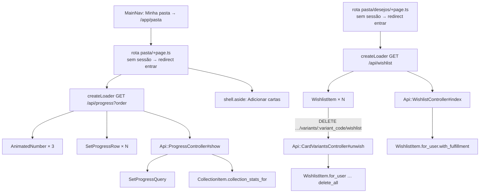

# Design — Pasta e lista de desejos na SPA

**Spec**: `.specs/features/spa-pasta/spec.md`
**Status**: Approved (abordagem A do carregador escolhida pelo dono em 2026-10-11)

Restrições ativas: AD-005 (`.context/` vence), AD-021 (a pasta Hotwire em três
consultas; a da API em duas, sem o bloco de decks), AD-022 (soma só em USD), AD-023
(SPA em `/app`, Hotwire no ar), AD-024 (jbuilder, tipos à mão no Svelte), AD-025 (dois
temas sobre tokens), AD-027 (P11: `DELETE …/variants/:variant_code/wishlist`, `200`
sem desejo). Nenhuma é superada. Não há lição confirmada no `lessons.json`.

**Pré-condição de execução:** a `spa-carta` encerrada. O link do desejo leva a
`/app/cartas/<card_number>` (rota da `spa-carta`), e a remoção entra como action nova
no `Api::CardVariantsController`, que é dela. Abrir a T1 com a `spa-carta` em execução
no mesmo worktree colide arquivos (`types.ts`, `card_variants_controller.rb`,
`config/routes.rb`).

---

## Architecture Overview

Duas metades com um contrato no meio, como nas fatias anteriores. No Rails, dois
controllers de leitura novos e uma action de remoção reaproveitam as consultas que a
pasta e a lista Hotwire já usam, sem mudar nenhuma delas. Na SPA, duas rotas exigem
sessão no `load` (redirect antes de chamar a API), carregam com um carregador genérico
(token de sequência, carga lenta após 200 ms) e montam componentes novos: o número
interpolado, a linha de set e o item de desejo.



### Abordagem do carregador (a escolha que pede o seu aval)

A `spa-catalogo` e a `spa-carta` já têm dois carregadores quase idênticos
(`catalog.svelte.ts` e `card-detail.svelte.ts`: token, `pending`, `skeleton` após
200 ms, `retry`, relança erro que não é `ApiError`). Esta fatia precisa de mais dois.

| | Abordagem | Custo | Risco |
|---|---|---|---|
| **A (recomendada)** | Um `createLoader<T>(fetch)` genérico em `src/lib/api/loader.svelte.ts`, usado pela pasta e pela lista de desejos. Os dois carregadores existentes ficam como estão; migrá-los vira dívida registrada, para depois do fechamento da `spa-carta` | Um módulo novo com teste próprio | Três formas do mesmo padrão até a migração |
| B | Copiar o `catalog.svelte.ts` duas vezes (`progress.svelte.ts`, `wishlist.svelte.ts`) | Zero abstração nova | Quatro cópias do mesmo token e do mesmo temporizador, cada uma com teste próprio repetido |
| C | O genérico da A e migrar já o catálogo e o detalhe | Consolida tudo de uma vez | Mexe em `card-detail.svelte.ts`, que a `spa-carta` ainda não commitou, e reabre testes da `spa-catalogo` já verificada |

A é a que entrega menos código sem tocar em feature aberta. O `notFound` do detalhe
fica fora do genérico: a pasta e a lista não têm 404.

---

## Code Reuse Analysis

### Existing Components to Leverage

| Componente | Local | Uso |
|---|---|---|
| `SetProgressQuery` (`order`, `Row#completion_percent`, `#displayed_owned_numbers`, `#completion_percent_known?`) | `app/queries/set_progress_query.rb` | Linhas de `sets` e o `order` normalizado (SPAS-38, SPAS-40); uma consulta |
| `CollectionItem.collection_stats_for` | `app/models/collection_item.rb:79` | `summary` e `value_by_set_id` (SPAS-39, SPAS-40); uma consulta |
| `WishlistItem.for_user(...).with_fulfillment` | `app/models/wishlist_item.rb:32,67` | Lista de desejos com `owned_quantity`, ordem por criação e id (SPAS-42); três consultas fixas (itens, variantes, cartas) |
| `WishlistItem#fulfilled?` | `app/models/wishlist_item.rb` | `fulfilled` do payload |
| `Api::BaseController` | `app/controllers/api/base_controller.rb` | Sessão, 401, 404, 422 de CSRF, `invalid_json` (SPAS-44, SPAS-45) |
| `Api::CardVariantsController#set_card_variant` | `app/controllers/api/card_variants_controller.rb` | Resolve carta + `variant_code` com 404 (SPAS-43, SPAS-44) |
| `cards/_price.json.jbuilder` (formato `"%.2f"`) | `app/views/api/cards/` | Mesma formatação de `amount`, sem `observed_at` |
| `api` (cliente), `ApiError` | `frontend/src/lib/api/` | Toda chamada; 401 vai a `handleUnauthenticated` (SPA-09) |
| `formatPrice`, `copies` | `frontend/src/lib/format.ts` | `US$ 1.234,56` e plural de cópia (SPAS-08, SPAS-23, SPAS-30) |
| `duration()` | `frontend/src/lib/motion.ts` | 320 ms ou 0 com reduced motion (SPAS-12, SPAS-14) |
| `Tween` | `svelte/motion` (Svelte 5.57.2, `node_modules/svelte/src/motion/tweened.js`) | Interpolação do número; `set(value, { duration, easing })` |
| `shell.aside`, `wide` | `frontend/src/lib/shell.svelte.ts` | "Adicionar cartas" na coluna lateral a partir de 64rem (SPAS-24) |
| `navEntries`, `appPath` | `frontend/src/lib/navigation/nav-entries.ts` | Troca do destino Hotwire de "Minha pasta" (SPAS-02); o `isCurrent` do `MainNav` já compara só o `pathname` |
| `entrar/+page.ts` (`await parent()` + `redirect`) | `frontend/src/routes/entrar/` | Mesmo padrão, invertido, para exigir sessão (SPAS-03) |
| `cardDetailHref` | `frontend/src/lib/cards/url.ts` | Link do desejo (SPAS-30) |
| `notifySuccess`, `notifyError` | `frontend/src/lib/toasts.svelte.ts` | Remoção (SPAS-33, SPAS-36) |
| `Button` | `frontend/src/lib/components/Button.svelte` | "Remover" e "Tentar novamente" |
| Disposição da `/progress` e da `/wishlist` | `app/views/progress/index.html.erb`, `app/views/wishlist_items/index.html.erb` | Textos e composição de referência (SPAS-26) |

### Integration Points

| Sistema | Integração |
|---|---|
| Rotas Rails | Três rotas no `scope "api"`, acima do catch-all: `get "progress"`, `get "wishlist"`, `delete "cards/:card_number/variants/:variant_code/wishlist"` (mesmas constraints do `put`) |
| Banco | Nenhuma migração; nenhuma escrita além do `DELETE` de `wishlist_items` |
| HTML | Nenhum controller, view ou rota HTML muda (SPAS-46) |
| Casco da SPA | "Minha pasta" passa a apontar para `/app/pasta` sem recarga |

---

## Components

### `Api::ProgressController#show` (Rails)

- **Purpose**: `{ data: { order, summary, sets } }` do usuário da sessão.
- **Location**: `app/controllers/api/progress_controller.rb`, `app/views/api/progress/show.json.jbuilder`
- **Interfaces**: `GET /api/progress?order=` → `200`.
  - `query = SetProgressQuery.new(Current.user, order: params[:order])`; `@order = query.order`; `@rows = query.call`; `@stats = CollectionItem.collection_stats_for(Current.user)`.
  - jbuilder: `summary.estimated_value` e cada `value` como `{ amount: format("%.2f", x), currency: "USD" }`; `value` vem de `@stats[:value_by_set_id].fetch(row.set_id, 0)`.
  - `base_size`: `row.completion_percent_known? ? row.base_size : nil`; `completion_percent`: o percentual arredondado com a mesma regra do `number_to_percentage(precision: 0)` do HTML, provado por teste em 1/8 (12,5% → 13) e 7/8 (87,5% → 88); `owned_numbers`: `row.displayed_owned_numbers`.
- **Dependencies**: sessão obrigatória (default do base, sem `allow_unauthenticated_access`).
- **Reuses**: as duas consultas da página HTML; duas consultas no total, fixas (SPAS-41).

### `Api::WishlistController#index` (Rails)

- **Purpose**: desejos do usuário da sessão.
- **Location**: `app/controllers/api/wishlist_controller.rb`, `app/views/api/wishlist/index.json.jbuilder`
- **Interfaces**: `GET /api/wishlist` → `200` `{ data: [{ card_number, card_name, variant_code, target_quantity, owned_quantity, fulfilled }] }`.
- **Reuses**: `WishlistItem.for_user(Current.user).with_fulfillment`.

### `Api::CardVariantsController#unwish` (Rails)

- **Purpose**: remover o desejo do usuário da sessão na variante (SPAS-43).
- **Location**: action nova no controller da `spa-carta`; view `unwish.json.jbuilder` com a forma de `wishlist.json.jbuilder` e `wishlist_target: nil`.
- **Interfaces**: `DELETE /api/cards/:card_number/variants/:variant_code/wishlist` → `200 { data: { variant_code, wishlist_target: null } }`.
  - `WishlistItem.for_user(Current.user).where(card_variant: @card_variant).delete_all`: idempotente, sem leitura prévia, e o `200` sai igual com zero ou uma linha apagada (AD-027).
- **Dependencies**: `before_action :set_card_variant` já existente (404 antes de apagar).
- **Reuses**: rota com as mesmas constraints do `put`.

### `createLoader<T>` (front)

- **Purpose**: carga com descarte de resposta obsoleta, carga lenta e repetição.
- **Location**: `frontend/src/lib/api/loader.svelte.ts`
- **Interfaces**:
  - `createLoader<T>(fetch: (key: string) => Promise<T>, slowMs = 200)` → `{ state, load(key), retry() }`
  - `state: { result: T | null; error: ApiError | null; pending: boolean; slow: boolean; seq: number }`
  - Erro que não é `ApiError` é relançado.
- **Reuses**: a forma de `catalog.svelte.ts`, sem copiá-lo.

### Guarda de sessão das rotas da pasta (front)

- **Purpose**: SPAS-03 sem chamar a API.
- **Location**: `frontend/src/routes/pasta/+page.ts` e `frontend/src/routes/pasta/desejos/+page.ts`, ambos chamando `requireSession(url)` de `frontend/src/lib/navigation/require-session.ts`.
- **Interfaces**: `requireSession(url: URL): void`: com `session.user` nulo, `redirect(307, '<base>/entrar?return_to=' + encodeURIComponent(url.pathname + url.search))`.
- **Por que no `load` e não num `$effect`:** o `load` roda antes de a página montar, então nenhuma chamada de API sai e nada pisca. Um `$effect` sobre `session.user` disputaria a navegação com o `signOut`, que zera o usuário e vai a `/app` (SPA-22): os dois `goto` correriam juntos. O `load` não reroda no `signOut`.

### `AnimatedNumber.svelte` (front)

- **Purpose**: o número interpolado dos indicadores (SPAS-12..16).
- **Location**: `frontend/src/lib/components/AnimatedNumber.svelte`
- **Interfaces**: props `value: number` (inteiro: contagem, ou centavos), `format: (n: number) => string`, `finalText: string` (o texto exato da resposta formatado).
  - Visível: `<span aria-hidden="true">` com `format(Math.round(tween.current))` e `font-variant-numeric: tabular-nums`; quando `tween.current === value`, exibe `finalText`.
  - Acessível: `<span class="visually-hidden">{finalText}</span>`, sempre o valor final. Sem `aria-live`.
  - `Tween` nasce em 0; um `$effect` chama `tween.set(value, { duration: duration(320), easing: easeStandard })`. Mesmo `value` não anima. Com reduced motion, `duration()` dá 0 e o primeiro quadro já é o final.
  - Dinheiro anima em **centavos inteiros** (`Math.round(Number(amount) * 100)` só para a trajetória) e termina em `finalText = formatPrice(amount, currency)`, então o último quadro nunca é `US$ 1.234,55` por ponto flutuante (SPAS-16).
- **Reuses**: `Tween`, `duration()`, `formatPrice`.

### `easeStandard` (front)

- **Purpose**: a curva `cubic-bezier(0.2, 0, 0, 1)` de `--ease-standard` em JS, porque o `Tween` recebe uma função e `svelte/easing` não tem essa curva.
- **Location**: `frontend/src/lib/motion.ts` (`cubicBezier(x1, y1, x2, y2)` + `easeStandard`).
- **Teste**: extremos 0 → 0 e 1 → 1, monotonia, e o literal comparado com o token de `tokens.css` para não divergirem.

### Rota `/app/pasta` (front)

- **Location**: `frontend/src/routes/pasta/+page.svelte`, `+page.ts`
- **Composição**: `<h1>Minha pasta</h1>`; região de conteúdo com `aria-busy` no estado lento; três cartões de indicador (rótulos e plural do SPAS-08, nota do SPAS-09); `<h2>Progresso por set</h2>` com a lista "Ordenar sets" de dois chips-link (`data-sveltekit-reset="false"`, `aria-current` por `data.order`); `<ul>` nomeada pelo `h2`, de `SetProgressRow`; grupo de ações secundárias (SPAS-25); "Adicionar cartas" no `shell.aside` quando `wide`, e abaixo de 64rem fixa acima da barra inferior, com `padding-block-end` na lista do tamanho da ação para não cobrir o último set.
- **Carga**: `$effect` sobre `page.url.searchParams.get('order')` e `session.user?.email` chama `loader.load(...)` com `?order=` só quando ele existe. A troca de ordem é só de query: o foco segue a regra da `spa-catalogo`.
- **Largura a 64rem (SPAS-11)**: grade `repeat(4, 1fr)` com três cartões, sem esticar.

### `SetProgressRow.svelte` (front)

- **Purpose**: uma linha de set (SPAS-19..23).
- **Location**: `frontend/src/lib/components/SetProgressRow.svelte`
- **Interfaces**: prop `set: ProgressSet`.
- **Detalhes**: link para `appPath('?sets[]=' + encodeURIComponent(code))` com `aria-label` "<name> (<code>): ver no catálogo"; com `base_size`, `<progress aria-hidden="true">` e legenda; sem, a frase de indisponível; parallels num `<p>` irmão do percentual (mesma lição do Hotwire); "valor" + `formatPrice`.

### Rota `/app/pasta/desejos` e `WishlistItem.svelte` (front)

- **Location**: `frontend/src/routes/pasta/desejos/+page.svelte`, `+page.ts`, `frontend/src/lib/components/WishlistItem.svelte`
- **Estado local**: `items` (`$state`) copiado de `loader.state.result` a cada `seq`; `removing` (`SvelteSet` de `svelte/reactivity`) com as chaves `card_number|variant_code` pendentes.
- **Remover**: ignora se a chave está em `removing`; chama `api.delete(...)` no caminho da variante; com `200`, calcula o destino do foco **sobre a lista do momento** (seguinte, anterior ou o `h1`), tira o item, `await tick()`, foca e chama `notifySuccess("Item removido da lista de desejos.")`; com `ApiError` que não seja `401` nem `session_changed`, `notifyError(message)` e o item fica; sempre tira a chave de `removing`.
- **Botão**: `Button` com alvo de 44px e `aria-label` "Remover <card_name> <variant_code> da lista de desejos (atendido)" ou "(faltam N)". Só o do item pendente fica desabilitado (SPAS-35).
- **Caminho**: `variantWishlistPath` em `frontend/src/lib/cards/url.ts`, ao lado de `variantApiPath`; se a `spa-carta` já tiver um caminho para o `PUT` do desejo, ele é reusado.

---

## Data Models

Sem migração. Contrato novo em `frontend/src/lib/api/types.ts`:

```typescript
type Money = { amount: string; currency: string };

type ProgressSet = {
  code: string;
  name: string;
  owned_numbers: number;
  base_size: number | null;
  completion_percent: number | null;
  parallel_owned: number;
  parallel_total: number;
  value: Money;
};

type ProgressPayload = {
  order: 'recent' | 'code';
  summary: {
    total_copies: number;
    distinct_variants: number;
    estimated_value: Money;
    unpriced_copies: number;
  };
  sets: ProgressSet[];
};

type WishlistEntry = {
  card_number: string;
  card_name: string;
  variant_code: string;
  target_quantity: number;
  owned_quantity: number;
  fulfilled: boolean;
};
```

`Money` não tem `observed_at` de propósito (spec, *Assumptions*): uma soma de preços com
datas diferentes não tem data.

---

## Error Handling Strategy

| Cenário | Tratamento | O que o usuário vê |
|---|---|---|
| Sessão anônima ao abrir a rota | `redirect` no `load`, antes da API | Tela de entrar com `return_to` (SPAS-03) |
| `401` numa consulta ou remoção | `onUnauthenticated` do cliente (SPA-09) | Tela de entrar com `return_to` da rota atual |
| `422 session_changed` na remoção | `onSessionChanged` do cliente (SPA-10) | Vai a `/app` com a nova sessão |
| Erro de rede ou `500` na consulta | `state.error` do carregador | `message` como veio e "Tentar novamente" (SPAS-07) |
| Erro na remoção | `notifyError(message)`, item fica | Toast de erro, item na lista (SPAS-36) |
| Desejo já removido em outra aba | `200` do servidor | Item sai como num sucesso (AD-027) |
| Carta ou variante inexistente no `DELETE` | `404 not_found` do base | Toast "Não encontrado." e item fica |
| Resposta obsoleta | Descartada pelo token | Nada (SPAS-05) |
| `order` inválido | Normalizado para `recent` no servidor | Chip "Recentes" marcado (SPAS-17, SPAS-38) |

---

## Risks & Concerns

| Concern | Location | Impact | Mitigation |
|---|---|---|---|
| Três formas do mesmo carregador | `frontend/src/lib/catalog/catalog.svelte.ts`, `frontend/src/lib/cards/card-detail.svelte.ts` | Uma correção num não chega aos outros | A abordagem A cria o genérico; migrar os dois fica como dívida no *Handoff*, depois do fechamento da `spa-carta` |
| `Tween` com relógio falso no jsdom | `svelte/motion` avança por `requestAnimationFrame` no `loop` interno | O teste de "aos 320 ms é o final" pode não avançar com `vi.useFakeTimers()` padrão | A task do `AnimatedNumber` começa provando que `vi.useFakeTimers({ toFake: ['requestAnimationFrame', 'performance'] })` avança o `Tween`; se não avançar, o teste espera o tempo real curto com `vi.waitFor`. Não verifiquei qual dos dois funciona |
| Arredondamento do percentual | `number_to_percentage(precision: 0)` no HTML versus o arredondamento na API | Divergência só em `.5` exato | Request test compara com a página HTML em 1/8 e 7/8 |
| Estouro de 408px da `/progress` a 390px | `.progress-set__code` e `.progress-set__catalog-link` no CSS Hotwire | Copiar a disposição copia o defeito | Os estilos da SPA não copiam o CSS Hotwire; e2e a 360px mede `scrollWidth <= clientWidth` com os 85 sets |
| "Adicionar cartas" fixa cobrindo o último set | Barra inferior abaixo de 64rem (`--z-nav`) | Último set inalcançável | `padding-block-end` da lista, medido no e2e: o último set rola até ficar acima da ação |
| `with_fulfillment` faz `includes` (três consultas) | `app/models/wishlist_item.rb:75` | Nenhum, é fixo | Request test conta consultas com 1 e com 10 itens |
| A pasta da API tem duas consultas, o HTML três | AD-021 | Nenhum | Teste próprio da API; `set_progress_plan_test.rb` intocado |

---

## Tech Decisions

| Decisão | Escolha | Por quê |
|---|---|---|
| Remoção de desejo | Action `unwish` no `Api::CardVariantsController`, `delete_all` escopado | Mesmo recurso do `PUT` (AD-027) e o mesmo `set_card_variant`; um controller por recurso |
| Exigir sessão na SPA | `redirect` no `+page.ts`, helper `requireSession` | Sem chamada de API nem pisca; sem corrida com o `signOut` |
| Número interpolado | `Tween` do Svelte, dinheiro em centavos, texto final da resposta | Nada de ponto flutuante no último quadro; o leitor de tela lê só o final |
| `shell.aside` reusado | O slot da `spa-catalogo` recebe "Adicionar cartas" | Segunda tela a usá-lo: vira AD-028 ("ação lateral de tela vai em `shell.aside`, um só nó no DOM, decidido por `wide`") |
| Remoção não otimista | O item sai depois do `200` | Spec (*Assumptions*): remoção não tem desfazer |

A AD-028 está no `STATE.md` (aprovação do design, 2026-10-11).
