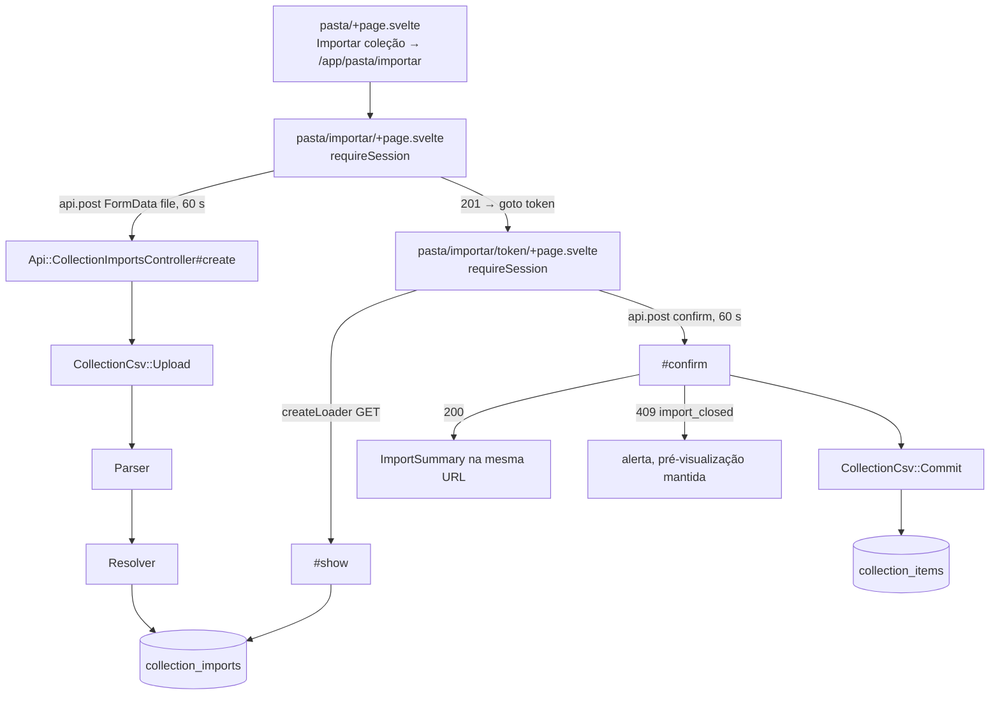

# Design — Import e export da coleção na SPA

**Spec**: `.specs/features/spa-portabilidade/spec.md`
**Status**: Approved (abordagem A do envio escolhida pelo dono em 2026-10-11; P13 segue na opção recomendada)

Restrições ativas: AD-005 (`.context/` vence), AD-006 (import substitui), AD-007
(staging em `collection_imports`), AD-008 (teto de 10.000 linhas), AD-023 (SPA em
`/app`, Hotwire no ar até a `spa-troca`), AD-024 (jbuilder, tipos à mão no Svelte),
AD-025 (dois temas sobre tokens). Nenhuma é superada. Não há lição confirmada no
`lessons.json`.

**Pré-condição:** `spa-pasta` encerrada (é: `validation.md` PASS na iteração 5). A
ação "Importar coleção" e o link do CSV moram em `src/routes/pasta/+page.svelte`.

---

## Architecture Overview

Duas metades com o contrato do spec no meio. No Rails, um controller novo sob `/api`
chama as mesmas peças do HTML (`Parser`, `Resolver`, `CollectionImport`, `Commit`),
sem tocar em nenhuma delas nem no `CollectionImportsController`. Na SPA, duas rotas
novas sob `/app/pasta/importar` exigem sessão no `load`, a primeira envia o arquivo
pelo cliente HTTP (que passa a aceitar `FormData` e tempo limite por chamada) e a
segunda lê a pré-visualização com `createLoader`, confirma e troca a tela pelo
resumo na mesma URL. O export não muda: continua o link de página inteira da pasta.



### Abordagem do envio (decisão do dono)

O `CollectionImportsController#create` HTML tem três pedaços de regra em métodos
privados: o teto de 12 MB pelo `Content-Length`, a reinterpretação dos bytes como
UTF-8 e o saneamento do nome. A API precisa dos três, e o SPOR-45 proíbe mudar o
controller HTML.

| | Abordagem | Custo |
|---|---|---|
| **A (recomendada)** | `CollectionCsv::Upload`, serviço novo que a API usa, com as três regras e as frases. O HTML fica intocado com a cópia dele; um teste de paridade fixa que as frases e os limites do serviço são os do `CollectionImportsController` | Duplicação de ~15 linhas até a `spa-troca` (STRO-25), que apaga o controller HTML; o serviço é o sobrevivente, não uma cópia órfã |
| B | Extrair o serviço e fazer o HTML usá-lo | Uma fonte só desde já, mas quebra o SPOR-45 ("controllers HTML inalterados") e exige emendar o Req. 22.45 |
| C | Repetir as três regras como privados do controller da API | Mesma duplicação de A, sem lugar testável fora do request test e sem dono quando o HTML sair |

A recomendação é A: cumpre o SPOR-45 ao pé da letra, deixa a regra num objeto com
teste unitário, e a duplicação tem data para acabar (a `spa-troca` já lista o
`CollectionImportsController` para remoção).

---

## Code Reuse Analysis

### Existing Components to Leverage

| Componente | Local | Uso |
|---|---|---|
| `CollectionCsv::Parser` | `app/services/collection_csv/parser.rb` | Sem mudança; `Result#aceito?`/`erro` |
| `CollectionCsv::Resolver` | `app/services/collection_csv/resolver.rb` | Sem mudança; `Linha` com `indice`, `classificacao`, `quantidade_antes/depois`, `mensagem` |
| `CollectionImport` | `app/models/collection_import.rb` | `create!`, `find_by_token_for`, `linhas_resolvidas` |
| `CollectionCsv::Commit` | `app/services/collection_csv/commit.rb` | `nil` → 404; `reivindicada?` falso → 409; `Result` → resumo |
| Frases e limites do HTML | `CollectionImportsController::MAX_CORPO_BYTES`, `MENSAGEM_*` | Referência do teste de paridade de `Upload` |
| `Api::BaseController#render_error` | `app/controllers/api/base_controller.rb` | Envelope de erro, `401` e `422 invalid_csrf_token` já prontos |
| `count_queries` | `test/services/collection_csv/export_test.rb:222` | Padrão do teste de consultas constantes (SPOR-44) |
| Teste de corrida do `Commit` | `test/integration/collection_import_commit_test.rb` | Padrão das duas threads (SPOR-42) |
| `createApiClient` | `frontend/src/lib/api/client.ts` | Ganha `FormData` e `timeoutMs` por chamada |
| `createLoader` | `frontend/src/lib/api/loader.svelte.ts` | Pré-visualização, carga lenta de 200 ms, "Tentar novamente" |
| `requireSession` | `frontend/src/lib/navigation/require-session.ts` | `load` das duas rotas (SPOR-03) |
| `FormError`, `Button` | `frontend/src/lib/components/` | Resumo de erro com foco (SPOR-07); botão pendente (SPA-21) |

### Integration Points

| Sistema | Integração |
|---|---|
| `config/routes.rb` | Três rotas no `scope "api"`, acima do catch-all `match "*path"` |
| Pasta da SPA | `href` de "Importar coleção" troca `/collection/import` com `data-sveltekit-reload` por `${base}/pasta/importar` sem recarga (SPOR-02); o teste da pasta que fixa o `href` antigo é atualizado (é teste do front, não Rails) |
| Export | Nenhuma: `/collection/export` continua o link da pasta (SPOR-33). O e2e usa esse CSV como retrato de `collection_items` |

---

## Components

### Rails

#### `CollectionCsv::Upload`

- **Purpose**: Transformar o arquivo enviado em pré-visualização gravada, ou numa frase de recusa.
- **Location**: `app/services/collection_csv/upload.rb`
- **Interfaces**:
  - `Upload.new(user, file, content_length).call → Result(preview, error)` — `error` é uma das frases do HTML (corpo grande, sem arquivo) ou a do `Parser`; `preview` é o `CollectionImport` criado.
  - Constantes `MAX_BODY_BYTES`, `MISSING_FILE_MESSAGE`, `BODY_TOO_LARGE_MESSAGE` com os mesmos valores do controller HTML.
- **Regras**: corpo declarado acima de 12 MB recusa antes de `read`; `file` sem `read` (ausente, string, corpo não multipart) é arquivo ausente; bytes lidos com `force_encoding(UTF_8)`; nome reduzido ao basename, `[^[:alnum:]._-]` → `_`, sem ponto inicial, 120 caracteres, `colecao.csv` quando vazio. Nada nasce em recusa.
- **Reuses**: `Parser`, `Resolver`, `CollectionImport.create!`.

#### `Api::CollectionImportsController`

- **Location**: `app/controllers/api/collection_imports_controller.rb`, views em `app/views/api/collection_imports/`.
- **Rotas** (no `scope "api"`, `constraints: { token: /[^\/]+/ }`):
  - `POST collection/imports` → `create`
  - `GET collection/imports/:token` → `show`
  - `POST collection/imports/:token/confirm` → `confirm`
- **create**: `Upload` com `params[:file]` e `request.content_length`. Recusa → `render_error(:unprocessable_entity, "validation_failed", "O arquivo não foi importado. Sua coleção não foi alterada.", { file: [erro] })`. Aceito → `201` com o payload de `show`.
- **show**: `CollectionImport.find_by_token_for(Current.user, params[:token])` ou `RecordNotFound` (404 do base). Sem filtro de prazo (lê vencido).
- **confirm**: `Commit.new(Current.user, params[:token]).call`; `nil` → 404; não reivindicada → `render_error(:conflict, "import_closed", MENSAGEM)`; senão `200` com o resumo. Nenhum outro parâmetro é lido.
- Sessão e CSRF vêm do base: nenhum `allow_unauthenticated_access`, nenhum `skip_forgery_protection`.
- **Classificação**: `CLASSIFICATIONS = { zera: "removes", cria: "creates", atualiza: "updates", rejeita: "rejected", inalterada: "unchanged" }.freeze` no controller, lida pelo partial.

#### Views jbuilder

- `_preview.json.jbuilder`: `token`, `filename`, `rows` de `linhas_resolvidas` na ordem guardada; `line = indice + 2`; `quantity_before` como veio (`nil` sem registro); `quantity_after` `nil` na `rejeita`; `message` só na `rejeita`.
- `show.json.jbuilder` e `create.json.jbuilder`: `json.data { json.partial! … }`.
- `confirm.json.jbuilder`: `filename`, `created = criadas`, `updated = atualizadas + zeradas`, `removed = zeradas`, `unchanged = inalteradas`, `rejected` de `rejeitadas_detalhadas` (`line`, `card_number`, `variant_code`, `card_name`, `message`), `failures` de `falhas` (`line`, `card_number`, `variant_code`). O `filename` vem de um `find_by_token_for` depois do `Commit`, como no HTML.

### SPA

#### Cliente HTTP (`client.ts`)

- `send` passa `FormData` como veio, sem `Content-Type` (o navegador põe o `boundary`), e serializa o resto em JSON como hoje.
- `post<T>(path, body?, options?: { timeoutMs?: number })`; o tempo limite padrão continua 15 s. O reenvio único do SPA-10 repassa o mesmo `body` e as mesmas opções (o `FormData` com `File` pode ser reenviado: não é um stream consumido).
- Continua o único módulo com `fetch` (regra do ESLint intocada).

#### `lib/imports/`

- Tipos em `lib/api/types.ts`: `ImportRow`, `ImportPreview`, `ImportSummary`, `ImportClassification`.
- `lib/imports/groups.ts` (puro): `groupRows(rows)` devolve `{ classification, title, support, label, rows }[]` na ordem fixa `removes, creates, updates, rejected, unchanged`, sem grupo vazio; `plural(n, one, many)`; `removalWarning(n)`. Um lugar para as frases do Req. 22.13, 22.18 e 22.24–27.
- `lib/imports/api.ts`: `importPath(token)` = `/api/collection/imports/${encodeURIComponent(token)}`, `confirmPath(token)` e `IMPORT_TIMEOUT_MS = 60000`.

#### Componentes

- `ImportRowItem.svelte`: uma linha da pré-visualização (rótulo, `card_number`, `variant_code` em `<code>`, nome, "Linha N do arquivo", antes e depois em elementos próprios, motivo). Interpolação simples, sem `{@html}`.
- `ImportSummary.svelte`: o resumo (h1 focável com `focus()` exportado, três contagens, frases de removidas, inalteradas, recusas e falhas, links finais).
- Grupos com marca de forma além da cor (borda lateral de espessura distinta e peso do cabeçalho no `removes`), sobre tokens existentes (`--danger` etc.), nos dois temas.

#### Rotas

- `src/routes/pasta/importar/+page.ts` e `[token]/+page.ts`: `await parent(); requireSession(url)`.
- `src/routes/pasta/importar/+page.svelte`: formulário com `<input type="file" name="file" required accept="text/csv,.csv">` e rótulo "Arquivo CSV"; envio por `api.post(…, formData, { timeoutMs: IMPORT_TIMEOUT_MS })` com guarda `pending`; `201` → `goto` para `${base}/pasta/importar/<token codificado>`; `422 validation_failed` → `FormError` com `message` e `fields.file`, `aria-describedby`/`aria-invalid` no input, `tick()` + `focus()`; outro erro → `message`. `401` e sessão trocada ficam com o cliente (SPA-09/10).
- `src/routes/pasta/importar/[token]/+page.svelte`: estado `view: 'preview' | 'summary'`, `confirming`, `confirmAlert`, `outcomeUnknown`. `createLoader` com a chave `token`; `404` → `message` + "Enviar um arquivo", outro erro → "Tentar novamente". Confirmar → `api.post(confirmPath(token), undefined, { timeoutMs: IMPORT_TIMEOUT_MS })`; `200` → `view = 'summary'`, `<title>` troca, `tick()` e foco no h1; `409 import_closed` → alerta e pré-visualização mantida; `network_error` → frase do SPOR-31, sem nova chamada. O `{#key}` por token recria o estado ao navegar entre tokens.

---

## Data Models

Nenhuma migração (P13 na opção recomendada). Contrato:

```typescript
type ImportClassification = 'removes' | 'creates' | 'updates' | 'rejected' | 'unchanged';

type ImportRow = {
  line: number;                    // indice + 2
  classification: ImportClassification;
  card_number: string | null;
  variant_code: string | null;
  card_name: string | null;
  quantity_before: number | null;  // null sem registro, nunca 0
  quantity_after: number | null;   // null na rejected
  message: string | null;          // só na rejected
};

type ImportPreview = { token: string; filename: string; rows: ImportRow[] };

type ImportSummary = {
  filename: string;
  created: number;
  updated: number;                 // inclui removed
  removed: number;
  unchanged: number;
  rejected: Array<Pick<ImportRow, 'line' | 'card_number' | 'variant_code' | 'card_name'> & { message: string }>;
  failures: Array<Pick<ImportRow, 'line' | 'card_number' | 'variant_code'>>;
};
```

---

## Error Handling Strategy

| Cenário | Tratamento | O que o usuário vê |
|---|---|---|
| Sem arquivo, corpo não multipart, campo como string | `Upload` → `422 validation_failed`, `fields.file` = frase de arquivo ausente | Resumo de erro focado, campo marcado |
| `Content-Length` > 12 MB | `Upload` recusa antes de `read` | Frase do limite de 8 MB |
| Parser recusa (`;`, vazio, Latin-1, > 10.000 linhas) | `422` com a frase do parser | Frase do parser |
| Token inexistente, alheio ou malformado | `404 not_found` igual nos dois endpoints | `message` + "Enviar um arquivo" |
| Já confirmada ou vencida; corrida perdida | `409 import_closed` | Alerta, pré-visualização mantida |
| Confirmação sem resposta / 60 s | `network_error` (status 0) | Frase do SPOR-31 + "Ver minha coleção", sem reenvio |
| Sessão expirada | `401` → SPA-09 com `return_to` da URL atual | Tela de entrar |
| Outra conta em outra aba | Reenvio de CSRF detecta e-mail diferente → SPA-10 | Aviso de sessão trocada; o token dá `404` na conta nova |
| `LoteGrandeDemais` ou exceção no `Commit` | `500 internal_error` do base, transação desfeita | "Erro inesperado. Tente novamente." |

---

## Risks & Concerns

| Concern | Location | Impact | Mitigation |
|---|---|---|---|
| Regra de envio duplicada entre HTML e API | `app/controllers/collection_imports_controller.rb:47-54,155-186` | Frase ou teto divergindo entre as duas telas | Teste de paridade em `upload_test.rb` compara constantes e o nome saneado com o controller HTML; a `spa-troca` apaga a cópia HTML |
| Tempo do `Commit` com 10.000 linhas não medido | `app/services/collection_csv/commit.rb:208` | Confirmação real passando de 60 s cai na frase do SPOR-31 com gravação feita | Task de medição do `Commit` e do render de 10.000 linhas antes de fechar; acima de 30 s, voltar ao dono (assíncrono está fora do escopo) |
| Resumo perdido em rede ruim (P13) | `commit.rb` não persiste `Result` | Usuário sem o resumo; a segunda tentativa diz "não foi alterada" sobre aquela tentativa | Frase do SPOR-31 manda conferir a pasta; persistir fica com o dono |
| `FormData` + reenvio de CSRF | `frontend/src/lib/api/client.ts` (`recoverFromStaleCsrf`) | Reenvio sem o arquivo ou sem o tempo limite de 60 s | Teste do cliente prova o mesmo `FormData` (com `file`) e o mesmo tempo limite no segundo `fetch` |
| `content_length` mentindo para menos | `request.content_length` | Arquivo grande lido para a memória | Já mitigado no HTML: o `Parser::MAX_BYTES` mede o conteúdo real; o `Upload` herda as duas camadas |
| 10.000 linhas no DOM | rota `[token]` | Render lento a 360px | Medir no e2e (tempo até o botão de confirmar visível); virtualização fora do escopo salvo reprovação |
| `href` da pasta fixado em teste | `frontend/src/routes/pasta/page.test.ts:248` | Teste da pasta falha ao trocar o destino | Atualizar a expectativa na mesma task do SPOR-02 (o SPAS-25 cede ao Req. 22.2) |

---

## Tech Decisions

| Decisão | Escolha | Razão |
|---|---|---|
| Dono da regra de envio na API | `CollectionCsv::Upload` (abordagem A) | Cumpre o SPOR-45 e sobrevive à `spa-troca` |
| Tempo limite por chamada | Opção `timeoutMs` no `post`, não um segundo cliente | Um cliente só para CSRF e `401` (SPA-06) |
| Mapa de classificação | Constante no controller da API, lida pelo jbuilder | Os símbolos do resolvedor não vazam para o contrato |
| Retrato de `collection_items` no e2e | CSV de `/collection/export` antes e depois | O e2e não tem acesso ao banco; o export é a descrição exata da coleção (POR-11) |
| `import_closed` | Novo código `409` na lista da API | Já no Req. 22.30 do `.context/requirements.md`; registrar no `CLAUDE.md` junto com os outros códigos |
