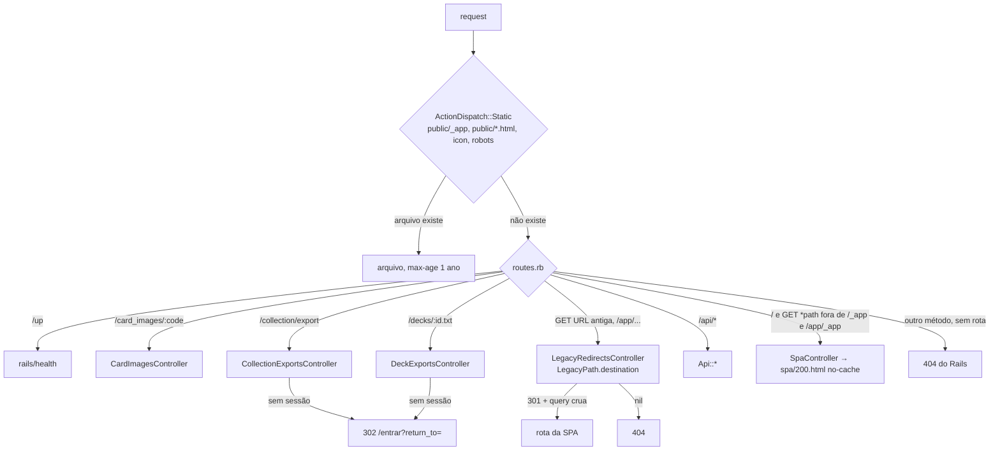
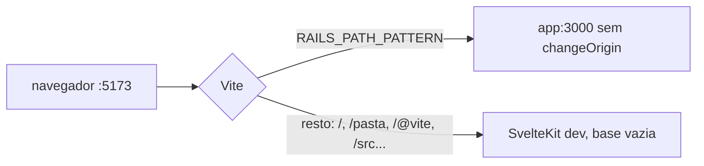

# Design — Troca do front: SPA na raiz e saída do Hotwire

**Spec**: `.specs/features/spa-troca/spec.md`
**Status**: Approved (dono, 2026-10-12: abordagem "controller + tabela" e emenda do STRO-32)

Restrições ativas: AD-005 (`.context/` vence), AD-012 (imagens servidas pelo app),
AD-021 (pasta numa consulta), AD-023 (SPA na mesma origem; o Hotwire sai na paridade),
AD-024 (jbuilder), AD-025 (tema por dispositivo), AD-031 (P14 downloads fora de `/api`;
P15 `301`). Nenhuma é superada. Não há lição confirmada no `lessons.json`.

**Pré-condições conferidas:** STRO-01 cumprido (as cinco fatias com `validation.md` PASS
e mescladas nesta branch em `179f45b` e `577ba17`); STRO-02 cumprido (SCAT-03 emendado e
`Verified` no spec da `spa-catalogo`, linha 261).

---

## Architecture Overview

O Rails passa a ter uma fronteira fechada (STRO-08), escrita em `config/routes.rb` nesta
ordem: `/up`, `/card_images/*`, as duas rotas de arquivo, as URLs antigas (Hotwire e
`/app/...`) apontando para um controller de redirecionamento, o escopo `/api` com o seu
catch-all, `root` e um fallback `*path` para a entrada da SPA. Os arquivos do build sob
`/_app/` e os de `public/` saem antes do roteador, pelo `ActionDispatch::Static`. A
entrada `200.html` sai de `public/` para não herdar o cache de um ano do servidor de
estáticos (STRO-07). Em desenvolvimento o Vite serve a SPA na raiz e encaminha ao Rails
só a mesma lista, por um proxy de lista positiva.



Em dev:



---

## Code Reuse Analysis

### Existing Components to Leverage

| Component | Location | How to Use |
|---|---|---|
| `SpaController` | `app/controllers/spa_controller.rb` | Mantido. Muda só a origem do arquivo (`config.x.spa_entry_path`); já responde `text/html`, `no-cache` e `404` sem entrada |
| `CollectionExportsController` | `app/controllers/collection_exports_controller.rb` | Mantido sem mudança de action (STRO-17) |
| `DecksController#show` (ramo `.txt`) | `app/controllers/decks_controller.rb:46-54` | A linha `render plain: Deck::ListText.format(@deck)` vai para `DeckExportsController`; `DeckDetail` sai do caminho (o `.txt` só precisa do deck com entradas) |
| `Authentication` | `app/controllers/concerns/authentication.rb` | Mantido para `ApplicationController` e `Api::BaseController`; `request_authentication` passa a mirar `/entrar` |
| `EditingDeck` | `app/controllers/concerns/editing_deck.rb` | Mantido; só perde o `helper_method` (não há view) |
| `safeReturnTo` | `frontend/src/lib/navigation/return-to.ts` | Reescrito para a raiz (STRO-20..22) com as mesmas recusas |
| `requireSession` | `frontend/src/lib/navigation/require-session.ts` | Mantido; o `return_to` gerado perde o `/app` naturalmente com a base vazia |
| Testes de API | `test/integration/api/**` | Destino das garantias (inventário); oito arquivos só trocam o login HTML pelo da API |
| `tokens.test.ts` | `frontend/src/lib/styles/tokens.test.ts` | Já é a porta do `test/design/contrast_test.rb`; o arquivo Rails sai sem destino novo |

### Integration Points

| System | Integration Method |
|---|---|
| Roteador | Ordem fixa em `routes.rb`; o fallback é a última rota; o catch-all da `/api` continua o último do escopo |
| Build | `Dockerfile` copia `build/_app` para `public/_app` e `build/200.html` para `spa/200.html` |
| Proxy do Vite | `vite.config.ts` lê o padrão de `frontend/rails-paths.ts` |
| Sessão | Mesmo cookie `session_id` e mesma sessão do Rails (STRO-24); nada muda em `Session` nem no cookie store |
| e2e | `baseURL` vira `http://frontend:5173/`; o healthcheck do `frontend` vira `/` |

---

## Components

### `LegacyPath`

- **Purpose**: Traduzir o caminho cru de uma URL antiga no caminho da SPA, sem banco e sem sessão (STRO-11..14).
- **Location**: `lib/legacy_path.rb` (o projeto já usa `autoload_lib`; teste em `test/lib/`)
- **Interfaces**:
  - `LegacyPath.destination(path: String, query: String) -> String | nil` — recebe `request.path` (codificação percentual intacta) e `request.query_string` crua; devolve `"<destino>"` ou `"<destino>?<query>"`, ou `nil` quando nenhuma regra casa ou o destino começaria por `//`.
- **Regras** (ancoradas, casam o caminho inteiro; `<s>` é um segmento sem `/`):

| Origem | Destino |
|---|---|
| `/catalog` | `/` |
| `/cards/<s>` | `/cartas/<s>` |
| `/session/new` | `/entrar` |
| `/registration/new` | `/criar-conta` |
| `/progress` | `/pasta` |
| `/wishlist` | `/pasta/desejos` |
| `/collection/import` | `/pasta/importar` |
| `/collection/import/<s>` | `/pasta/importar/<s>` |
| `/decks` | `/baralhos` |
| `/decks/new` | `/baralhos/novo` |
| `/decks/import` | `/baralhos/importar` |
| `/decks/<s>` | `/baralhos/<s>` |
| `/decks/<s>/edit` | `/baralhos/<s>/renomear` |
| `/decks/<s>/delete` | `/baralhos/<s>/excluir` |
| `/app` | `/` |
| `/app/<resto>` | `/<resto>` (o resto pode ter `/`) |

- **Dependencies**: nenhuma.
- **Reuses**: nada; é a tabela da checklist de paridade do spec.

### `LegacyRedirectsController`

- **Purpose**: Responder `301` para o destino de `LegacyPath`, ou `404`.
- **Location**: `app/controllers/legacy_redirects_controller.rb`
- **Interfaces**: `#show` — `redirect_to destination, status: :moved_permanently` ou `head :not_found`.
- **Dependencies**: `ActionController::Base` direto, como o `SpaController`: sem `Authentication`, sem `allow_browser`, sem leitura de sessão (STRO-13). Só rotas `GET` (e `HEAD` por extensão) apontam para ele; outro método não tem rota e cai no `404` do Rails (STRO-15).
- **Reuses**: `redirect_to` com string que começa por `/` só prefixa protocolo e host, sem `URI.parse` (conferido em `actionpack-8.0.5.1/lib/action_controller/metal/redirecting.rb:159-175`), então a codificação do segmento e da query passa byte a byte (STRO-14).

### Rotas (`config/routes.rb`)

- **Purpose**: A lista fechada do STRO-08.
- **Forma final**, nesta ordem:

```ruby
get "up" => "rails/health#show", as: :rails_health_check
get "card_images/:variant_code" => "card_images#show", ...           # sem mudança
get "collection/export" => "collection_exports#show", as: :collection_export
get "decks/:id.txt" => "deck_exports#show", as: :deck_export, format: false,
    constraints: { id: /[^\/.]+/ }

# URLs antigas (STRO-11, STRO-12): só GET, destino calculado do caminho.
%w[catalog cards/:id session/new registration/new progress wishlist
   collection/import collection/import/:token decks decks/new decks/import
   decks/:id decks/:id/edit decks/:id/delete].each do |path|
  get path => "legacy_redirects#show", format: false, constraints: { id: /[^\/]+/, token: /[^\/]+/ }
end
get "app(/*path)" => "legacy_redirects#show", format: false,
    constraints: ->(req) { !req.path.start_with?("/app/_app/") }

scope "api", ... do ... match "*path", to: "not_found#show", via: :all end

root "spa#show"
get "*path" => "spa#show", format: false,
    constraints: ->(req) { !req.path.start_with?("/_app/", "/app/_app/") }
```

- `decks/:id.txt` vem antes de `decks/:id`; `decks/new` e `decks/import` antes de `decks/:id`.
- O fallback é `get`: `POST /collection_items/1/increment` não casa nada e é `404` (STRO-15).
- `/200.html` cai no fallback (o arquivo não está mais em `public/`), saindo `no-cache` (STRO-07).

### `DeckExportsController`

- **Purpose**: `GET /decks/:id.txt` com a mesma resposta de hoje (STRO-18).
- **Location**: `app/controllers/deck_exports_controller.rb`
- **Interfaces**: `#show` — `deck = Current.user.decks.find(params[:id])`; `render plain: Deck::ListText.format(deck)` (o `render plain:` já sai `text/plain; charset=utf-8`).
- **Dependencies**: `ApplicationController` (sessão exigida; deck alheio é `RecordNotFound` → `404`, DCK-36).
- **Reuses**: `Deck::ListText.format`. O teste de bytes de `deck_export_test.rb` prova a paridade.

### `ApplicationController` e `Authentication`

- **Purpose**: Base das rotas que não são `/api`: os downloads e `CardImagesController`.
- **Mudanças**:
  - `request_authentication` → `redirect_to "/entrar?return_to=#{ERB::Util.url_encode(request.fullpath)}"` (`302`, STRO-19). Some a escrita de `session[:return_to_after_authenticating]`.
  - Saem `after_authentication_url` e a preservação de `return_to` em `start_new_session_for` (STRO-26); o `reset_session` fica.
  - Sai `helper_method :authenticated?` (não há view).
  - `allow_browser versions: :modern` fica: `CardImagesController` herda dele hoje e o STRO-28 proíbe mudar a resposta.
- `Api::BaseController` sobrescreve `request_authentication` e não muda.

### `SpaController` e entrada da SPA

- `config.x.spa_entry_path = Rails.root.join("spa/200.html")` (fora de `public/`, ignorado pelo git).
- Sem mudança de código no controller.

### Front na raiz (`frontend/`)

- **`vite.config.ts`**: sai `paths: { base: '/app' }`; o proxy usa `RAILS_PATH_PATTERN` de `frontend/rails-paths.ts`:

```ts
// Mesma lista do STRO-08, menos /_app (no dev o Vite não serve build).
export const RAILS_PATH_PATTERN =
  '^/(api|card_images|up|app|catalog|cards|session|registration|progress|wishlist' +
  '|collection|collection_items|decks|icon\\.png|icon\\.svg|robots\\.txt|[0-9]{3}[^/]*\\.html)(/|\\?|$)';
```

  `collection_items` e os prefixos antigos entram para que um `POST` velho chegue ao Rails e
  receba o `404` (STRO-15) em dev também. `/decks` não colide com `/baralhos`.
- **`return-to.ts`** (STRO-20..22): decodifica; recusa `//`, `\`, controle e segmento `.`/`..`
  como hoje; remove o prefixo `/app` (`/app` → `/`, `/app/x` → `/x`); exige começar por `/`;
  `/api/`, `/_app/` e `/card_images/` viram `/`. Exporta `isFileRoute(path)` (`/collection/export`
  ou `/decks/<s>.txt`, com ou sem query).
- **Entrar e criar conta**: depois do login, `isFileRoute(destino)` → `window.location.assign(destino)`;
  senão `goto(destino)` (STRO-22).
- **Base vazia**: os 14 usos de `resolve('/').replace(/\/$/, '')` viram `resolve('/')`. Com base
  vazia o `replace` daria string vazia, e `redirect(307, '')` ou `href=""` quebrariam calados.
- **`src/routes/+error.svelte`** (STRO-10): `<h1>Página não encontrada</h1>`, `<title>Página não
  encontrada — Bindr</title>`, link "Ir para o catálogo" para `resolve('/')`; renderizado dentro
  do `+layout.svelte` (casco). Para erro diferente de 404 mostra a mesma estrutura com
  "Algo deu errado" — não há outro erro de carga hoje, os `load` lançam só `redirect`.
- **Varredura do STRO-03**: Vitest `src/no-removed-routes.test.ts` lê `src/**/*.{svelte,ts}` por
  `import.meta.glob(..., { query: '?raw', eager: true })` e falha em `href`/`goto`/`redirect` para
  os prefixos removidos; só `/collection/export` e `/decks/{...}.txt` passam.
- **Testes do front**: os mocks de `$app/paths` e as URLs esperadas trocam `/app/...` por `/...`
  (57 arquivos com `/app`). É mudança de resultado do spec (STRO-09), não de implementação.
- **e2e**: `baseURL: 'http://frontend:5173/'`; os testes que leem HTML (lista no inventário,
  seção e2e) passam a ler a API ou o banco (STRO-34).

### Build e dependências

- **`Dockerfile`**: sai `RUN SECRET_KEY_BASE_DUMMY=1 ./bin/rails assets:precompile`; o estágio
  final copia `build/_app` → `/rails/public/_app` e `build/200.html` → `/rails/spa/200.html`; o
  estágio Node confere que `build/` só tem `_app` e `200.html` (um arquivo novo do build não
  some calado).
- **`.gitignore`**: `/public/app` → `/public/_app` e `/spa`.
- **Gemfile**: saem `propshaft`, `importmap-rails`, `turbo-rails`, `stimulus-rails` (STRO-27) e
  `hotwire-spark` (dev; depende só de `rails`, `listen`, `zeitwerk`; sai com as linhas
  `config.hotwire.spark.*` de `development.rb`). `jbuilder` fica (API). `capybara` e
  `selenium-webdriver` ficam: não são do Hotwire e não há system test (fora do escopo).
- **P16 verificado**: `railties-8.0.5.1/lib/rails/application/configuration.rb:130` só toca
  `assets` sob `respond_to?(:assets)`; no app, `config.assets` aparece só em
  `config/initializers/assets.rb`, e `assets:precompile` só no `Dockerfile`. Saem os dois. A
  prova final é o boot da suíte e o `docker build` (STRO-35).
- **Arquivos removidos** (STRO-25): os dez controllers HTML; `app/views/*` exceto `api/`
  (inclui `layouts/`, `pwa/` e os layouts de mailer); `app/helpers/`; `app/assets/`;
  `app/javascript/`; `vendor/javascript/`; `config/importmap.rb`; `bin/importmap`;
  `config/initializers/assets.rb`; `app/mailers/application_mailer.rb` (sem mailer real, e
  o `layout "mailer"` ficaria apontando para view removida).

---

## Data Models

Nenhum. Sem migração; `db/structure.sql` não muda (STRO-29).

---

## Error Handling Strategy

| Error Scenario | Handling | User Impact |
|---|---|---|
| URL antiga sem regra (ex.: `/decks/1/x`) | `LegacyPath` → `nil` → `404` | Página 404 do Rails |
| `/app//evil.com` | Destino começaria por `//` (protocolo relativo): `nil` → `404`, nunca `redirect_to` (que levantaria `UnsafeRedirectError`, 500) | 404 |
| `POST`/`PATCH`/`DELETE` em rota removida | Sem rota → `404`, nada gravado | Aba velha recebe 404; recarregar leva à SPA |
| Chunk velho `/app/_app/...` ou `/_app/inexistente.js` | Excluído das duas constraints → `404` | O navegador recarrega o app |
| Caminho desconhecido na raiz | Fallback → SPA → `+error.svelte` 404 | "Página não encontrada" no casco, HTTP 200 |
| Download sem sessão | `302 /entrar?return_to=...`; depois do login, navegação de página inteira | Baixa o arquivo |
| `spa/200.html` ausente (imagem sem build) | `SpaController` já responde `404` | Erro visível no deploy |

---

## Risks & Concerns

| Concern | Location (file:line) | Impact | Mitigation |
|---|---|---|---|
| **STRO-32 não cabe como escrito**: oito testes de API e de query autenticam pelo login HTML ou comparam com página Hotwire | `api/cards_test.rb:28`; `api/catalog_test.rb:31,117,203`; `api/collection_imports_confirm_test.rb:101-125`; `api/decks_test.rb:76,143,158,182`; `api/decks_write_test.rb:49`; `api/decks_destroy_select_test.rb:50,66,107`; `queries/set_progress_plan_test.rb:153-207,467-624,705`; `queries/collection_csv_plan_test.rb:186-248,417` | Removido o HTML, quebram; "sem edição" é impossível | **Emenda ao Req. 23.32 / STRO-32 (aprovada em 2026-10-12)**: esses arquivos só podem perder o login HTML (trocado por `POST /api/session`) e as metades que comparam com o HTML ou leem CSS; nenhuma asserção sobre a API ou o query muda, e cada edição entra no inventário. |
| Redirecionamento aberto por `//` | `lib/legacy_path.rb` (novo) | `/app//evil.com` → `Location: //evil.com` ou 500 | Regra explícita e teste com `/app//evil.com` e `/app/%2F%2Fevil.com` (este último fica `/%2F%2Fevil.com`, caminho local) |
| `resolve('/').replace(/\/$/, '')` com base vazia vira `''` | 14 arquivos em `frontend/src` | Redirect para string vazia, `href=""` | Trocar por `resolve('/')` na mesma task da base; a varredura do STRO-03 e os testes de página pegam o resto |
| Cache de um ano na entrada | `config/environments/production.rb:19` | `/200.html` em `public/` sairia `max-age` 1 ano | Entrada fora de `public/`; teste de `/200.html` com `no-cache` |
| Proxy de dev e roteador com duas listas | `frontend/rails-paths.ts`, `config/routes.rb` | Rota nova de um lado só engole a SPA ou some no dev | Vitest do padrão contra a lista do STRO-08 e contra as rotas da SPA; edge case do spec exige emenda do STRO-08 antes de caminho novo |
| `Commit` do import só testado pelo HTML | `test/integration/collection_import_commit_test.rb` | Remover o HTML tira a prova de atomicidade, savepoint e reivindicação única | `test/services/collection_csv/commit_test.rb` novo, antes da remoção (inventário) |
| `authentication_test` injeta controller de sonda em `ApplicationController` | `test/integration/authentication_test.rb` | Provas de cookie (params, não assinado, destruída) somem | `test/integration/api/session_cookie_test.rb` contra um endpoint `/api` autenticado |
| Volume de testes do front | 57 arquivos com `/app` | Diff grande e mecânico | Task própria, só substituição de prefixo, gate quick |
| Comentários de rotas e controllers mantidos citam o HTML | `config/routes.rb`, controllers mantidos | Comentário errado após a troca | Reescritos nas tasks que tocam cada arquivo |

---

## Inventário de testes (STRO-30, STRO-31)

Uma linha por arquivo que sai ou muda. "Garantia" é a regra que sobrevive; o destino é o
teste que a prova depois da troca. **Novo** = arquivo criado nesta feature antes da remoção.
Levantado em 2026-10-12 lendo origem e destino; o Verifier confere por amostragem.

### Arquivos de teste novos (destino das faltas)

| Arquivo novo | Prova (origem) |
|---|---|
| `test/integration/api/session_cookie_test.rb` | `session_id` em params ignorado, cookie não assinado ignorado, sessão destruída não autentica (authentication:152,160,169); troca de conta no mesmo cookie jar troca o dono da escrita e do cálculo (collection_authorization:258, progress_authorization:252); header `X-User-Id` ignorado (progress_authorization:294,319, collection_imports:274); login com e-mail em outra caixa (sessions:114); `editing_deck` nulo depois de logout e login (sessions:166) |
| `test/integration/api/collection_csv_roundtrip_test.rb` | export → `POST /api/collection/imports` → `confirm` deixa a coleção idêntica; três ciclos; bytes iguais; acento, vírgula e aspas; vários sets; quantidade zero (roundtrip:178,197,213,229,251,269); dois usuários com o mesmo arquivo ficam independentes, e a confirmação não toca outra conta (roundtrip:359,391,415,464,493; commit:289) |
| `test/services/collection_csv/commit_test.rb` | rejeitada não vira escrita, por decisão (commit:191,218,252); staging é a única entrada (361); reivindicação em um `UPDATE` condicional, segunda tentativa afeta zero, mesma transação com savepoint (468,492,539); falha de linha, falha não-AR e erro do driver não desfazem as anteriores, `SignalException` propaga (636,657,682,704,720); `LoteGrandeDemais` antes de gravar (736); absorção e recriação (766,793); `Result` sem a linha falha e sem falhas vazias (summary:227,628,660) |
| `test/integration/api/deck_guarantees_test.rb` | id de deck que mudou de dono na sessão não vale (deck_editing:86); chave sai da sessão na exclusão (deck_editing:71); incremento contra deck apagado é 404 sem gravar (deck_entries_concurrency:194); `GET /api/decks/:id` sem erro com entrada sumindo (214); consultas do show constantes com as entradas (deck_page:217); import com 5 cópias é 201 `invalid` (deck_imports:173); importar duas vezes cria dois decks (deck_imports:92) |
| `test/integration/api/wishlist_fulfillment_test.rb` | posse 1 < alvo 2 não atende (wishlist_items:213); posse zero (255); posse de outra variante da mesma carta não atende (283); atendimento derivado sem escrita (298,309); variante fora da fonte continua listada (335) |
| `test/integration/api/progress_plan_test.rb` | `GET /api/progress` com três agregações além da sessão, uma `-- listDeckShortfall` (set_progress_plan:153,180,207) |
| `test/integration/api/authorization_surface_test.rb` | rotas de progresso e import sem segmento de usuário (progress_authorization:353, collection_imports:472,504); token do import não sequencial (collection_imports:410) |
| `test/lib/legacy_path_test.rb` | tabela inteira, codificação, query crua, `//` (STRO-11..14) |
| `test/integration/legacy_redirects_test.rb` | `301` e `Location` por linha da checklist e por `/app...`; zero consultas; `404` de `POST`/`DELETE` em rota removida com tabelas intactas (STRO-11..15, STRO-33) |

### Arquivos que ficam e mudam

| Arquivo | Mudança |
|---|---|
| `test/integration/spa_test.rb` | `/app...` → raiz; `/200.html` `no-cache`; `/_app/x.js` e `/app/_app/x.js` `404` (STRO-05..07, STRO-32) |
| `test/integration/collection_exports_test.rb` | login pela API; anônimo → `302 /entrar?return_to=%2Fcollection%2Fexport` (STRO-19) |
| `test/integration/deck_export_test.rb` | login pela API; anônimo → `302 /entrar?return_to=%2Fdecks%2F<id>.txt`; sai o teste do link da página (41) |
| `api/cards_test`, `api/catalog_test`, `api/collection_imports_confirm_test`, `api/decks_test`, `api/decks_write_test`, `api/decks_destroy_select_test` | só login pela API e retirada das metades que leem HTML (emenda do STRO-32) |
| `queries/set_progress_plan_test.rb`, `queries/collection_csv_plan_test.rb` | as medições de requisição HTML vão para `api/progress_plan_test` e `POST /api/collection/imports`; saem os blocos de CSS; as asserções de plano ficam |
| `card_images_test`, `card_images_tcgplayer_test` | nenhuma |

### `test/integration/` removidos

| Arquivo | Classe | Garantia → destino |
|---|---|---|
| authentication_test | garantia | público sem sessão → `api/catalog_test:130`, `api/cards_test:81`, `api/catalog_test:101`; exige sessão → `api/wishlist_test:100`, `api/progress_test:180`; cookie → `api/sessions_test:55,189` + **novo** `session_cookie_test`; "volta à origem" HTML sai |
| card_detail_absent_variant_test | garantia | `queries/card_detail_test:30-117`, `api/cards_test:107,122,158`, `queries/catalog_presence_test:56,72,92` |
| card_detail_deck_controls_test | markup | `editing_deck` → `api/cards_editing_deck_test:33-63` |
| card_detail_header_test | markup/CSS | — |
| card_detail_hero_image_test | markup | — |
| card_detail_image_test | markup | isolamento do selo → `api/cards_test:81,89` |
| card_detail_layout_test | markup | — |
| card_detail_price_test | markup | preço → `api/cards_test:62,179`, `models/card_variant_price_test` |
| card_detail_test | markup | campos, 404 → `api/cards_test:38,151`, `models/card_display_field_test` |
| card_detail_variant_choice_test | markup | `?variant=` → `api/cards_test:137,143`, `queries/card_detail_test:65-92` |
| card_detail_variants_test | Turbo | — |
| catalog_filter_controls_test | markup | filtros → `queries/catalog_query_test`, `api/catalog_test:48` |
| catalog_filters_toggle_test | markup | — |
| catalog_grid_test | markup | parâmetro inválido, `user_id`, anônimo → `api/catalog_test:62,70,101,111,196`, `queries/catalog_ownership_test:142,148` |
| catalog_layout_structure_test | markup | — |
| catalog_ownership_filter_test | markup | isolamento da posse → `api/catalog_test:83,94,101,175`, `queries/catalog_ownership_test:131-148` |
| catalog_status_line_test | markup/CSS | — |
| catalog_tile_test | markup | isolamento → `api/catalog_test:101,111,175`, `queries/variant_holdings_test:33,85` |
| code_identifiers_ui_test | CSS | — |
| collection_authorization_test | garantia | escrita alheia → `api/card_variants_test:171,182`, `models/collection_item_atomic_test:65`, `models/collection_item_test:170-192`; troca no mesmo cookie jar → **novo** `session_cookie_test` |
| collection_csv_roundtrip_test | garantia | `api/collection_imports_create_test:81`, `collection_exports_test:156`, `services/collection_csv/export_test:173`, `resolver_test:456` + **novo** `api/collection_csv_roundtrip_test` |
| collection_export_link_test | markup | substância duplica `collection_exports_test:76,112` |
| collection_import_commit_test | garantia | `api/collection_imports_confirm_test:78,126,142,181,195,208,224`, `api/collection_imports_concurrency_test:104`, `api/collection_imports_create_test:81`, `show_test:63` + **novo** `services/collection_csv/commit_test`, **novo** `api/collection_csv_roundtrip_test` (289) |
| collection_import_preview_ui_test | markup | não grava ao renderizar e token alheio → `api/collection_imports_show_test:55-63,77,94` |
| collection_import_summary_test | garantia | contagens → `api/collection_imports_confirm_test:78,159,224` + **novo** `commit_test` |
| collection_imports_test | garantia | `api/collection_imports_create_test:65,81,104,137,148,157,168`, `show_test:55,77,94`, `services/collection_csv/parser_test:166-343`, `upload_test:60,73,122,145` + **novo** `session_cookie_test`, `authorization_surface_test` |
| collection_items_test | garantia | `api/card_variants_test:57,76,88,99,120,145,171`, `api/card_variants_concurrency_test:149`, `models/collection_item_atomic_test:22-57` |
| collection_ownership_ui_test | Turbo/ARIA | posse da sessão e consultas → `api/cards_test:89`, `queries/variant_holdings_test:85`, `api/catalog_test:137` |
| color_chip_ui_test | markup | — |
| deck_editing_test | garantia | `api/decks_write_test:34`, `api/decks_destroy_select_test:57,70,98`, `api/cards_editing_deck_test:57,63` + **novo** `deck_guarantees_test` |
| deck_entries_concurrency_test | garantia | `api/deck_entries_concurrency_test:135,145,158,175,201` + **novo** `deck_guarantees_test` (194, 214) |
| deck_entries_test | garantia | `api/deck_entries_test:48-170`, `models/deck_entry_atomic_test:18-63` |
| deck_folder_shortfall_test | garantia | `api/decks_shortfall_test:48,69`, `queries/deck_shortfall_query_test:99` |
| deck_imports_test | garantia | `api/deck_imports_test:40-118`, `models/deck/list_text_test:65-246` + **novo** `deck_guarantees_test` |
| deck_layout_markup_test | markup | — |
| deck_leader_test | garantia | `api/deck_entries_test:94,110,118,153,170` |
| deck_page_test | garantia | `models/deck_test:68`, `models/deck/legality_test:48-185`, `api/decks_test:96,116,148,162` + **novo** `deck_guarantees_test` (217) |
| deck_rename_delete_test | garantia | `api/decks_write_test:53,68,86,122,140`, `api/decks_destroy_select_test:33,98` |
| deck_shortfall_page_test | garantia | `queries/deck_shortfall_query_test:51,64,191`, `api/decks_test:116` |
| decks_test | garantia | `api/decks_write_test:34,68,86,140`, `api/decks_test:47,54,186` |
| flash_ui_test | markup | — |
| minha_pasta_test | garantia | `models/collection_item_test:203-259`, `api/progress_test:50,180,188` |
| navegacao_principal_test | markup | navegação → Vitest do casco |
| ownership_badge_ui_test | markup | — |
| progress_authorization_test | garantia | `api/progress_test:50,188`, `queries/set_progress_query_test:316,321,326,352,359,670` + **novo** `session_cookie_test`, `authorization_surface_test` |
| progress_order_test | garantia | `api/progress_test:107,114`, `queries/set_progress_query_test:752-837` |
| progress_test | garantia | `api/progress_test:180,188` |
| progress_ui_test | garantia | `queries/set_progress_query_test:173-685`, `queries/set_progress_numbers_test:65-150`, `api/progress_test:130,142,155` |
| progress_value_test | garantia | `models/collection_item_test:287-389`, `api/progress_test:83,95` |
| sessions_test | garantia | `api/end_to_end_test:43`, `api/sessions_test:69,140,153,189`, `api/registrations_test:47,59-93`, `models/user_password_test:31,94` + **novo** `session_cookie_test` |
| set_progress_bar_test | markup | número → `queries/set_progress_query_test:529`, `api/progress_test:142` |
| wishlist_items_test | garantia | `api/card_variants_wishlist_test:64-184`, `api/wishlist_test:46,74,90,100`, `api/card_variants_unwish_test:58-118` + **novo** `wishlist_fulfillment_test` |
| wishlist_mark_ui_test | markup | — |

### `test/design/` e `test/helpers/` removidos

Todos são markup ou CSS do Hotwire (leem `app/assets/stylesheets/catalog.css` por
`support/stylesheet.rb` ou leem `app/views`); nenhum prova dado. Contraste e tokens já têm
porta em `frontend/src/lib/styles/tokens.test.ts`.

`card_detail_media_test`, `card_detail_ownership_buttons_test`, `card_detail_variants_grid_test`,
`catalog_grid_canvas_test`, `catalog_search_styling_test`, `catalog_subgrid_layout_test`,
`class_coverage_test`, `code_style_test`, `content_rules_test`, `contrast_test`,
`deck_layout_test`, `detail_layout_test`, `filter_layout_test`, `filters_toggle_layout_test`,
`flash_test`, `focus_obscured_test`, `focus_test`, `layout_test`, `literal_values_test`,
`navigation_button_styling_test`, `navigation_canvas_test`, `navigation_layout_test`,
`ownership_badge_test`, `palette_test`, `progress_add_cards_test`, `progress_bar_render_test`,
`progress_canvas_test`, `progress_line_test`, `tokens_test`, `support/stylesheet.rb`;
`helpers/catalog_helper_test` (equivalente em `frontend/src/lib/catalog/url.ts`),
`helpers/prices_helper_test` (o formato do preço é do front).

### e2e que comparam com o HTML (STRO-34)

| Spec | Teste | Novo oráculo |
|---|---|---|
| `catalogo.spec.ts` | paridade `/` × `/catalog` (117); OP01-024 primeiro (128) | `GET /api/catalog` com a mesma query |
| `carta.spec.ts` | `registerParityTests` (232, nos describes 295 e 351) | `GET /api/cards/:n?variant=` |
| `pasta.spec.ts` | 232, 460, 498 (indicadores e valor); 517 (só captura do HTML) | `GET /api/progress`; a captura do HTML sai |
| `pasta-desejos.spec.ts` | 186, 250, 282 | `GET /api/wishlist` |
| `baralhos.spec.ts` | 246, 281, 317, 351 (o `.txt` fica) | `GET /api/decks`, `/api/decks/:id` |
| `baralhos-montagem.spec.ts` | 171, 224 | `GET /api/decks/:id`, `/api/decks/shortfall` |
| `importar.spec.ts` | 334, 441 | `GET /api/collection/imports/:token` e banco pela API |
| `catalogo-interacao.spec.ts:93`, `catalogo-layout.spec.ts:315` | registram posse por `/cards/<n>` | `POST /api/cards/:n/variants/:v/increment` |

---

## Tech Decisions

| Decision | Choice | Rationale |
|---|---|---|
| Onde mora o redirecionamento | Controller + tabela pura (escolha do dono) | Codificação byte a byte sem `URI.parse`; regra testável sem HTTP; rotas visíveis em `bin/rails routes` |
| Onde fica a entrada | `spa/200.html`, fora de `public/` | `public_file_server.headers` é global (1 ano em produção) |
| `request_authentication` dos downloads | `302` para `/entrar?return_to=` com `ERB::Util.url_encode(request.fullpath)` | STRO-19; `url_encode` codifica `/` como `%2F`, igual ao exemplo do spec |
| Ordem das tasks | 1) testes de garantia novos sobre o código atual; 2) SPA na raiz e Rails servindo a raiz (HTML ainda no ar nas rotas próprias); 3) corte: rotas antigas viram redirecionamento, sai o HTML com os testes do inventário, downloads e `Authentication` mudam; 4) gems, assets, `Dockerfile`; 5) e2e; 6) documentos | Cada commit com a suíte verde; as garantias existem antes de o HTML sair (STRO-31) |
| `hotwire-spark` e mailer | Saem | Sem HTML não há o que recarregar; mailer sem uso apontaria para layout removido |
| Proxy de dev | Lista positiva num módulo próprio | Com base vazia os internos do Vite ficam na raiz, e a regex negativa de hoje deixaria de funcionar |
